# Racecraft

**An F1 race replay and strategy workbench, built on public timing data.**

Racecraft replays any Formula 1 session since 2023 on a live track map, with
every car's telemetry, the timing tower and race control. It also models what
the public feed does not show: tyre wear, the cost of a pit stop, when each car
is best off stopping, whether an undercut will work, and how the race is likely
to finish, called from Friday and Saturday's running.

It runs as a Windows desktop app, or as a local web app in any browser.

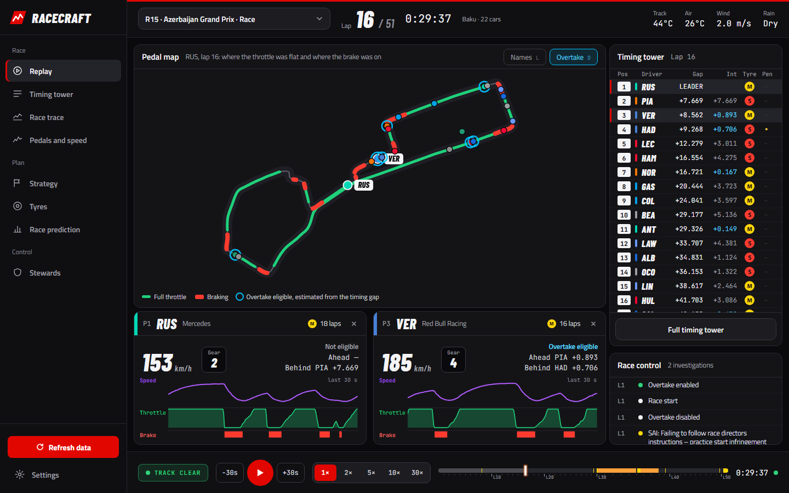

---

## Contents

- [What it does](#what-it-does)
- [The screens](#the-screens)
- [How it works](#how-it-works)
- [The models, and how good they are](#the-models-and-how-good-they-are)
- [Setup guide](#setup-guide)
- [Using the app](#using-the-app)
- [Command line](#command-line)
- [Live timing](#live-timing)
- [Building the Windows installer](#building-the-windows-installer)
- [Development](#development)
- [Project layout](#project-layout)
- [Configuration](#configuration)
- [Security](#security)
- [Limits, and what the data cannot tell you](#limits-and-what-the-data-cannot-tell-you)
- [Data, licences and credits](#data-licences-and-credits)

---

## What it does

- **Replays any session** from 2023 to now (practice, qualifying, sprint and
  race; 430 sessions, 86 races) with the cars moving on a map drawn from their
  own GPS positions, at 1x to 30x.
- **Shows what each car is doing**: speed, gear, throttle, brake, DRS (or, from
  2026, overtake mode), and the last 30 seconds of it as a trace.
- **Compares two drivers' laps metre for metre**: where each brakes, how hard
  they carry speed, where the time is gained.
- **Works out strategy**: what wear and the pit lane cost at each circuit, the
  cheapest plans with and without safety cars, when each car should stop, and
  the odds that stopping first wins a place.
- **Predicts the race** from practice, qualifying, the sprint and recent form,
  as each driver's chance to win, reach the podium and score, checked against
  every race since 2023. On a sprint weekend it **predicts the sprint** too,
  from sprint qualifying, checked against every sprint since 2023.
- **Keeps the championships**: drivers' and constructors' points, as they stood
  at any session of the season, matching F1's published tables, and **each
  driver's and team's chance of the title**, the rest of the season simulated.
- **Ranks the pit crews**: which teams turn a car round fastest, from every
  green-flag stop of the season, measured against each race's typical stop.
- **Explains race control**: every steward's verdict and track message in plain
  words, with what it means for the result.
- **Follows a session live** from F1's own timing feed (no subscription needed).
- **Keeps itself current**: the desktop app fetches the latest race weekends
  while it is open.

Every model is held out: for a race that has happened, it is fitted only on
races before it, so what you see is what it would have said at the time.

---

## The screens

The app has a navigation rail on the left and a playback bar along the bottom.
Every screen except the replay and settings can pop out into a window of its
own (the ↗ button), which follows the main window's clock: put the timing tower
on a second monitor.

| | |
|---|---|
| **Replay**: the pedal map (the circuit coloured by a followed car's last lap: green where the throttle was flat, red where it braked), cards for up to two followed drivers with their last 30 s of speed, throttle and brake, the timing tower and race control. |  |
| **Timing tower**: every car's gap, interval, last and best lap, the three sectors in timing colours (purple fastest, green personal best, yellow slower), tyre and age, stops, overtake and penalties. Sort by race order, grid or best lap. | 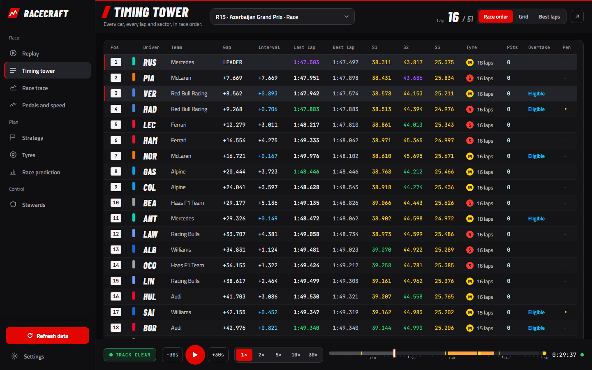 |
| **Race trace**: gap to the leader, interval or lap time, lap by lap, drawn only up to the lap on the clock so nothing is spoiled. Safety-car laps are shaded; click to jump to a lap. | 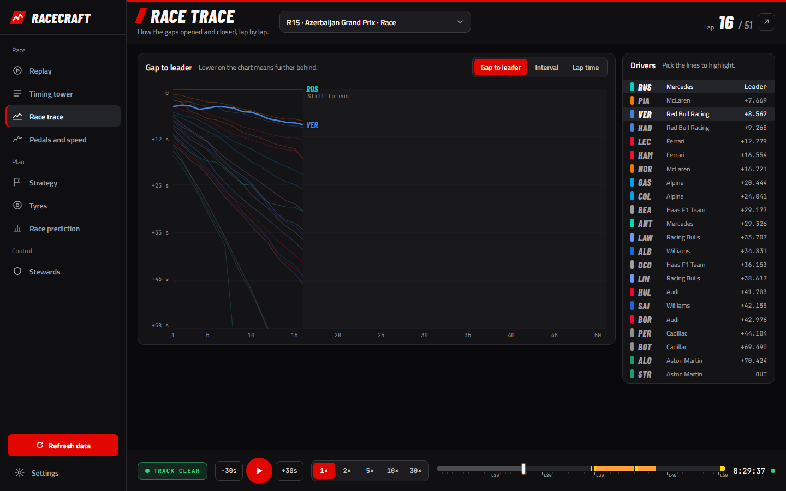 |
| **Pedals and speed**: one driver's lap against another's by distance: the time between them, speed, throttle, brake and gear, the corners marked, a cursor through every trace and the pedal map, and each brake zone side by side. | 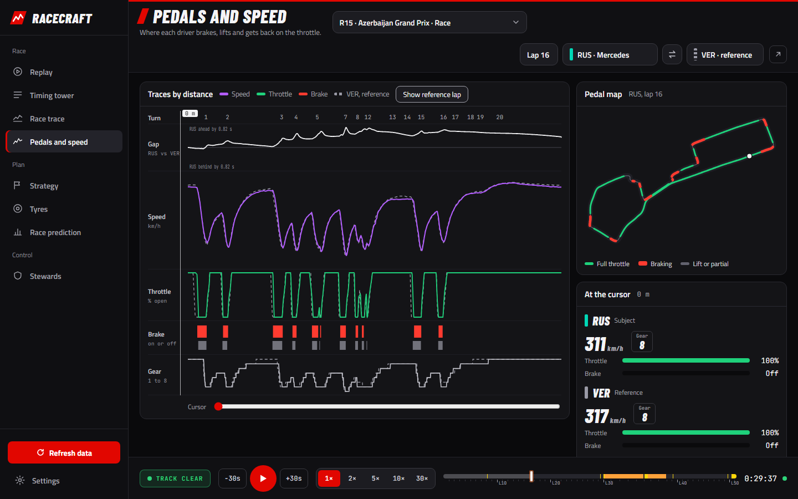 |
| **Strategy**: each car's pit window and most likely stop lap, the undercut watch (chance that stopping first gets the place) and a stint map. *What if* holds the cheapest plans, with safety cars and raced in places. | 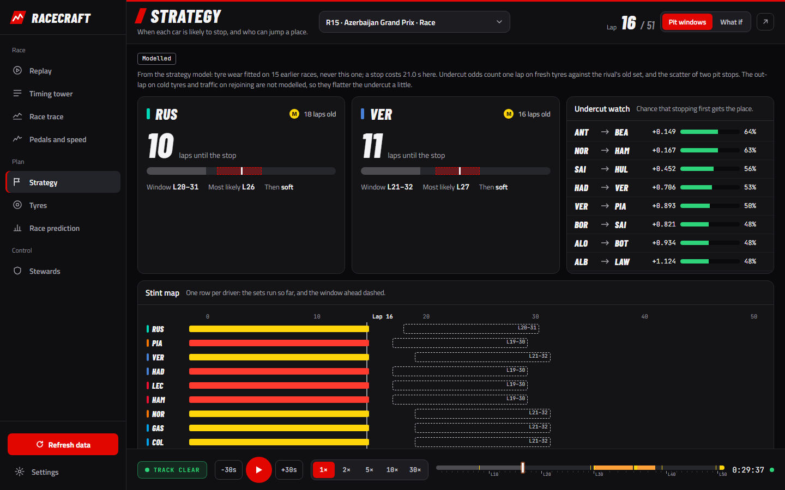 |
| **Tyres**: the wear curve per compound with every car placed on it, the race's own tyres as optional hindsight, and every car's sets through the weekend. | 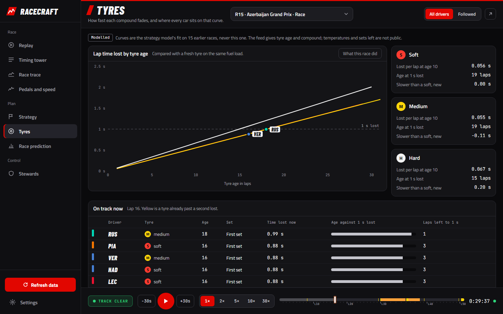 |
| **Race prediction**: the favourite, the podium chances, the full predicted order with each driver's likely range, and after the race the result beside it, scored against the grid. On a sprint weekend, switch between the Grand Prix and the sprint. | 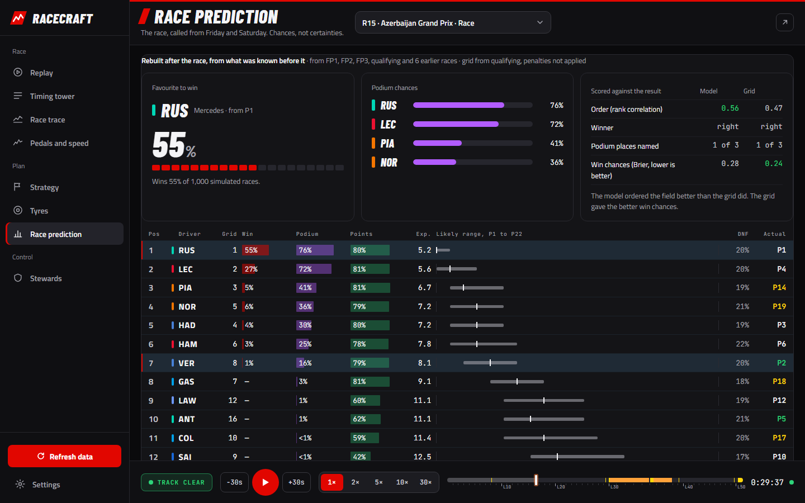 |
| **Stewards**: every race control message explained (what it is, its status, its effect on the race) and the flags and safety cars across the race. | 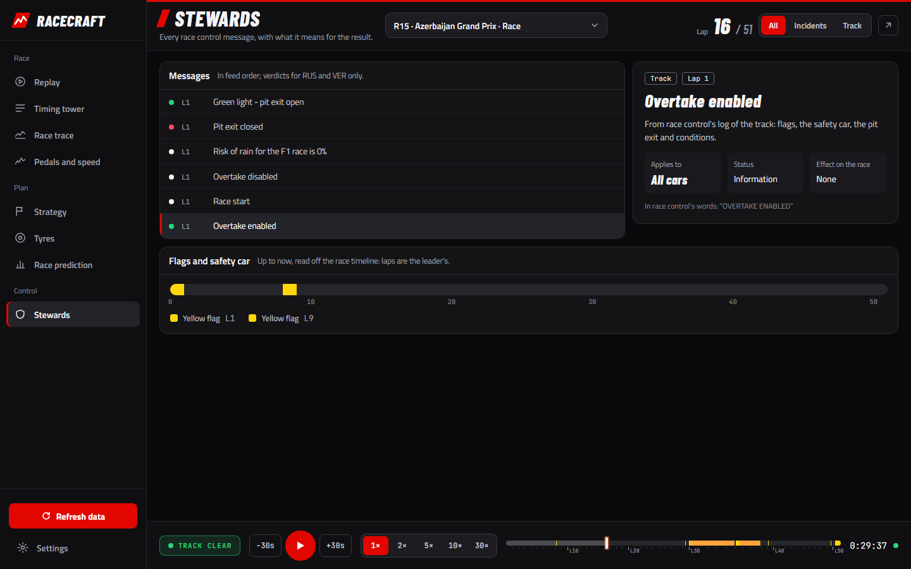 |
| **Standings**: the drivers' and constructors' championships as they stood going into the session (so a race is not spoiled) or after it: points, gap to the leader, wins, podiums, the last five Grand Prix finishes, places gained since the last weekend, and who scored each team's points; and each driver's and team's chance of the title, or "out" once they can no longer reach the leader. | 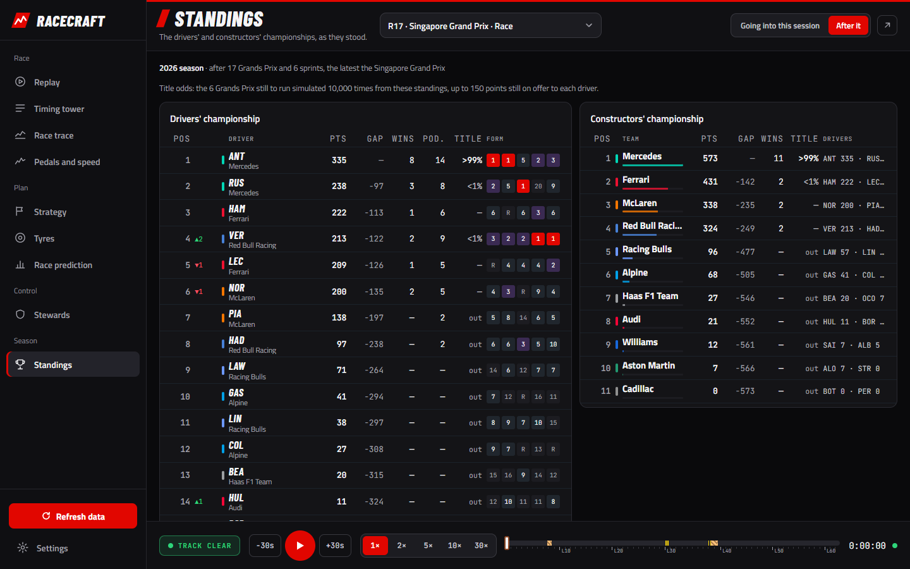 |
| **Pit crews**: every team's crew ranked by its typical stop against the race's typical stop, with how consistent it is and how often a stop went slow; below, this session's stops up to the replay clock, each saying why if it is not counted (a safety car, a penalty, a red flag). | 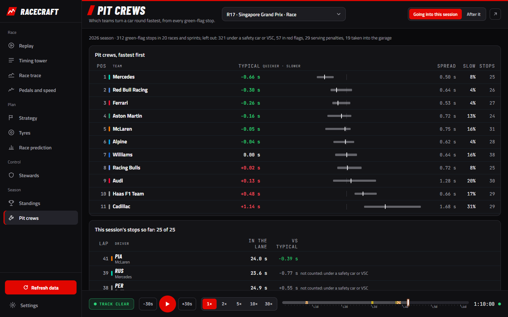 |
| **Settings**: units, row density, the header clock, the map's names and overtake rings, and refreshing the data. | 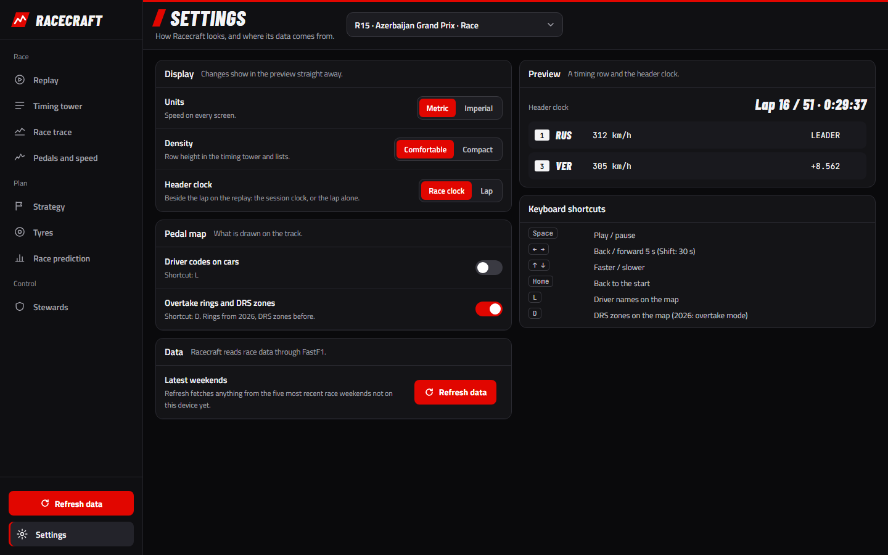 |

---

## How it works

```
 F1 timing feed ──► FastF1 ──► ingest ──► Parquet lake ──► DuckDB ──► models ──► FastAPI ──► React app
 (historic + live)            (checks)   data/lake/           (queries)   (Python)   (JSON API)   in a desktop window
                                          one file per                                            or a browser
                                          table per session
```

- **Ingest** (`racecraft-ingest`) pulls each session through
  [FastF1](https://github.com/theOehrly/Fast-F1): laps, results, car telemetry
  (speed, throttle, brake, gear, DRS, about four samples a second), GPS
  positions, weather, race control and track status. It checks the data before
  writing and stores it as Parquet, one file per table per session, in
  `data/lake/` (about 1.5 GB for 2023 to 2026).
- **DuckDB** reads the lake in place. The small tables are held in memory; the
  telemetry stays on disk and is read one session at a time.
- **The models** (Python, numpy and pandas) fit tyre wear, pace and pit loss
  from earlier races, simulate races car by car, and predict results. See
  below.
- **The API** (FastAPI) serves a session at any instant: the running order, every
  car's position and telemetry, race control, and the models' answers.
- **The interface** (React and TypeScript, built with Vite) draws it. The map and
  the telemetry are buffered ahead of the clock and interpolated between
  samples, so playback is smooth at every speed.
- **The desktop app** wraps the same thing in its own window (pywebview on
  Windows' WebView2), with no terminal and no port to remember.

---

## The models, and how good they are

Each is described in full, with the measurements behind it, in
[docs/TECHNICAL.md](docs/TECHNICAL.md).

- **Tyre wear and pace.** Fitted per season on clean race laps, with fuel burn
  and track evolution separated from wear. Compounds are compared on the same
  fuel load.
- **The circuit.** Pit lane loss measured from green-flag stops, safety-car
  and VSC rates (shrunk toward the league average for circuits with little
  history), and how often cars actually pass.
- **Strategy.** Every plan costed in seconds (tyres, compounds, stops), then
  re-ranked under random safety cars, then raced against the whole field in a
  car-by-car simulator that knows the wake of the car ahead and how hard
  passing is at this circuit, so it scores plans in **places**, not seconds.
- **Pit windows and the undercut.** For each car at the clock's moment: the
  stop lap that loses least over the rest of the race, every lap within two
  seconds of it, and for close pairs the chance that one lap on fresh tyres
  beats the gap, given the scatter of two pit stops.
- **Race prediction.** Each driver's race pace is estimated from qualifying,
  practice long runs, the sprint, recent form and (early in a season) last
  season's form, each weighted by how well it predicted real races, then the
  race is simulated 1,000 times. Replayed over every race since 2023, each
  predicted only from what was known before it:

  | | Finishing order (rank correlation) | Win chances (Brier, lower is better) |
  |---|---|---|
  | 2023 to 2025, 69 races | **0.69** model, 0.66 grid | **0.54** model, 0.63 grid |
  | 2026 (a new rulebook, never trained on), 16 races | **0.66** model, 0.64 grid | **0.46** model, 0.50 grid |

  It beats "everyone finishes where they started" every season, by a small
  margin; the grid already holds most of what is knowable on Saturday night.
  On naming the winner it ties pole.
- **Sprint prediction.** The same, made once sprint qualifying is in: each
  driver's pace from the sprint qualifying gap, FP1 long runs and recent race
  pace, weighted by how well each predicted past sprints, then the sprint
  simulated 1,000 times over its own distance with no stops. Replayed over every
  sprint since 2023:

  | | Finishing order (rank correlation) | Win chances (Brier, lower is better) |
  |---|---|---|
  | 2023 to 2025, 18 sprints | 0.76 model, 0.75 grid | **0.53** model, 0.59 grid |
  | 2026 (never trained on), 5 sprints | 0.87 model, 0.88 grid | **0.38** model, 0.39 grid |

  On the order it ties the grid: a sprint is short, nobody stops, and the
  field mostly finishes where it started. Its chances are the more honest,
  for the win and the podium alike.
- **Title odds.** The rest of the season simulated 10,000 times from the
  standings: each driver's pace from recent race form, uncertain in two
  measured parts (how far form misses a driver's level, drawn once a season,
  and how much their pace strays race to race, drawn every race), with
  retirements at the season's rate and F1's points. Replayed over 2023 to 2025
  from every round, it gave the eventual champion a 66% chance on average,
  against 49% for the same simulation knowing only the points (Brier 0.33 vs
  0.45), most clearly early in a season. In 2025's close three-way finish it
  did slightly worse than the points alone.
- **Pit crews.** The feed gives when a car crossed the pit-lane entry and exit
  lines, not how long it stood still, so a stop is its pit-lane time against the
  same race's typical stop: the lane is the same for everyone there. Only
  green-flag stops with new tyres count; safety cars (the lane runs 3 to 4 s
  quicker under one at Monaco and Baku), red flags, penalties and trips to the
  garage are left out and counted. A team's figure in one half of a season's
  races predicts the other half closely (split-half correlation 0.80 to 0.91),
  so the order is the crews', not chance.
- **Overtake mode (2026).** The feed never says when a driver used it, so a car
  is shown as *eligible* when race control has it switched on and the car was
  within a second of the one ahead at the last timing line. An estimate, and
  labelled as one.

---

## Setup guide

### What you need

| | Version | Check with |
|---|---|---|
| Bahrain | 5.333 km | 5.412 km |
| Silverstone | 5.822 | 5.891 |
| Monza | 5.757 | 5.793 |
| Zandvoort | 4.204 | 4.259 |
| Monaco | 3.265 | 3.337 |

`tests/test_outline_realdata.py` keeps this honest; it skips when the lake is
missing.

**The position feed's timestamps jitter**, at intervals of 0.08-0.50 s where
the cadence is 0.24 s, while the positions themselves are smooth. Sampling an
even grid straight off those timestamps makes a car leap: 4.9% of intervals
imply over 340 km/h when the cars never exceed 331.

Smoothing the coordinates does not fix this and makes it worse - median
filtering, trajectory smoothing and an even cadence were all measured and all
lost. The noise is in the *mapping from time to distance*, so that is what is
smoothed: distance along the car's own path is fitted against time with a
local straight line over half a second. Positions are never altered, only the
judgement of how far along the path the car had got at each instant.

| | Over 340 km/h | p99 | Path moved by |
|---|---|---|---|
| Raw | 4.9% | 424 km/h | — |
| Smoothed, 0.5 s | **0.02%** | **312 km/h** | 1.3 m |

A metre on a circuit 5 km round is invisible; the leaping is not.
`?smooth=0` on `/frames` returns the raw feed, and `smooth=0.8` steadies it
further at the cost of about 2.4 m.

Genuine position jumps remain and are left alone: the feed occasionally lags
and catches up in one step, moving a car over 60 m in about 0.1% of samples.

### Gaps

Gaps are derived the way broadcast timing derives them, from line-crossing
times, because the public feed carries no interval field. A car is only shown
as lapped when the leader had completed more laps *at the moment that car last
crossed the line*; comparing current lap counts would label the whole field
"+1 LAP" for most of every lap.

### Race control

The feed carries 9,947 race and sprint messages and, until now, the interface
read none of them. They are the only place it says *why* something happened, so
`api/penalties.py` reads them into per-car state: seconds still to serve, stop/go
and drive-through penalties outstanding, open investigations, deleted lap times.
The tower's **PEN** column shows the most consequential thing outstanding against
each car and the whole standing in its tooltip. The **Stewards** panel, beside the
track map, holds the verdicts themselves — it is watched rather than consulted, and
news behind a tab is news nobody sees. It takes width the map was not using, so
the tower keeps its floor and the charts below keep their height; below 1360px it
drops under the map rather than squeezing three columns.

Kept deliberately plain. Two lines per verdict — who and what, then the offence —
because four columns in a narrow panel crush all four. No controls of its own: the
tower's selection is the only filter, which is how every other panel here narrows
already. Emphasis carries the hierarchy, a penalty loud and anything settled grey.

Race control is two separate panels in the right-hand column: **Stewards**
beside the map and **Track** beside the charts below it, each a full row high
and each scrolling on its own. Both are always visible, with nothing hidden
behind a control.

The track list is short because the feed's churn is left out. `Event.topic`
splits race control three ways rather than two: a blue flag is shown to one
lapped car as it is passed and a sector flag repeats every time a sector changes
state, and together those are **4,771 noise messages** against 3,257 from the
stewards and 1,919 genuine track events. What is left — the safety car, the race
flags, the pit exit, DRS, a slippery patch, a recovery vehicle, a resumption
order — is a median of **18 events a race**, which is short enough to read. The
line is drawn on the flag words rather than on the phrase "IN TRACK SECTOR",
because `TRACK SURFACE SLIPPERY IN TRACK SECTOR 11` is a condition worth reading
and 176 of those were swept up by the looser rule.

Deleted lap times are left out of the verdicts list too, and they are **47% of
every steward message** (1,533 of 3,257): in a race a deletion is a track-limits
tick, and what matters is how many a car has collected, which is exactly what the
PEN column counts. Nothing is lost — every message is still served by the API
(`?topic=track`, `?topic=noise`) and still counted against the driver.

The **PEN** column answers one question, *does this car still owe something?*, and
shows four marks rather than a vocabulary: `DSQ` out of the race, `+5s` for time
still to serve, `STOP` for a stop/go or drive-through, `•` while the stewards are
looking, `–` for nothing. An earlier version answered five questions with eight
marks, which had to be learned before the column meant anything; everything
settled — a served penalty, a deleted lap, a black-and-white flag — is in the
tooltip and the panel instead, because it changes no decision.

What counts as the stewards' is whether the message carries a verdict, not
whether it says `FIA STEWARDS:`. Only 971 of the 3,257 do, so filtering on the
prefix would drop **70%** of them — no lap deletion carries it and most incident
notices do not either. Nothing with the prefix lacks a verdict, so the verdict is
the stronger test. The filter is applied server-side before the limit, so asking
for the stewards' last sixty returns sixty of theirs rather than sixty of
everything of which twenty happen to be theirs.

It is a pure function of the message table and a time, like `timing.classify`
beside it. That is what makes scrubbing correct: an accumulator would be wrong
the moment the clock went backwards, and the scrubber, the -30s button and live
"following" all move it freely. At lap 12 the column shows what was known at lap
12 however the clock got there, and it is computed at the same `t` as the gap
next to it, so the two cannot describe different moments.

Parsed rather than judged, because the FIA's text is machine-generated and its
grammar is rigid. Three measurements over every race and sprint in the lake set
the shape of it, and each corrected an assumption:

* **Anchoring on the word CAR is wrong.** `CARS 31 (OCO), 77 (BOT) AND 20 (MAG)`
  writes it once for three cars, and requiring it found only the first on
  **1,514 messages** — every multi-car incident silently lost all but one car.
  The three-letter code is the anchor instead, and the number in front of it is
  the car. That code is also what makes extraction safe: a message is full of
  other numbers — `1:40.956`, `TURN 9`, `LAP 10`, `14:23:43` — and none of them
  is followed by one. 3,229 of 3,256 car-concerning messages match; the 27 that
  do not name no car, or name a team, which is resolved to that team's cars.
* **Two things match that are not cars, and one of them is dangerous.** A
  deletion ending `... 16:12:10 (PIT)` offers `10 (PIT)`, and 10 is a real
  driver — so a message about car 23 charges a deleted lap to car 10. `CAR 26
  (BED)` is the other kind: a real car in another championship sharing the feed.
  **337** phantom matches are rejected across the lake, **200** of them carrying
  a number that belongs to an actual driver. Timestamps are stripped before
  scanning and every number is checked against this session's driver list.
* **An incident is reported four times, not once.** Noted, then under
  investigation, then a penalty or no further action — so counting messages
  counts one incident four times. They are tied together instead: 15.8% carry a
  trailing `(15:03:08)` that is the incident's own identity, and the rest match
  on the offence plus an overlapping car, which links **88.1%** of noted
  incidents to a later verdict. Matching on the offence alone was wrong and the
  test that proves it is a real race: at 2026 Spain, SAI was in a TURN 8
  collision with COL and another with HUL twenty seconds later, both `CAUSING A
  COLLISION`. The second merged into the first and was cleared by the first's
  verdict. A closing verdict may now only attach to an open incident whose cars
  its own are a subset of.

The verdicts are a closed set and `_classify` leaves nothing unread across all
3,256. `tests/test_penalties.py` guards that against a new season's wording —
it is what caught `STOP-AND-GO` as a second spelling of `STOP/GO`, and the one
`BLACK FLAG` in the lake, a disqualification that had been folded in with the
black-and-white warning flag.

What no rule reaches is whether an awarded time penalty was **served at a stop
or added to race time at the flag**. `PENALTY SERVED` settles 48 of 235; the
rest are left pending rather than guessed at. That matters beyond the display:
235 in-race penalty messages stand against 1,958 measured green-flag stops, and
a penalty served at a stop inflates that stop's cost *inside* the 5–60 s window
`model/circuit.py` keeps — so pit loss quietly absorbs it. Deciding it is a
question about a sequence rather than a string, which is the one place in this
feature a judgment would earn its keep.

### API

| Endpoint | Purpose |
|---|---|
| `GET /api/sessions` | every session in the lake |
| `GET /api/sessions/{key}` | drivers, track outline, session bounds |
| `GET /api/sessions/{key}/state?t=` | one instant: order, gaps, tyres, positions, telemetry, penalties |
| `GET /api/sessions/{key}/frames?start=&end=&hz=` | a window of positions for playback |
| `GET /api/sessions/{key}/laps` | the whole race trace, plus leader crossing times |
| `GET /api/sessions/{key}/messages?until=&limit=&topic=` | race control up to `until`, newest first, each message read; `topic` is `stewards`, `track` or `noise` |
| `GET /api/sessions/{key}/insight` | degradation, pit loss, neutralisation risk, ranked plans, plans checked per car |
| `GET /api/sessions/{key}/tyre-sets` | every car's sets at the start of the session and during it |
| `GET /api/sessions/{key}/places?grid=&tyres=` | plans raced against the field, ranked in places, on that car's tyres or new ones |
| `GET /api/circuits` | measured pit loss and neutralisation risk, every circuit |

**The server no longer crashes on long sessions.** DuckDB kills the process with a native fault after roughly 1,000–3,000 repeated scans of a table spread over many Parquet files (reproduced on 1.4.5, 1.5.4 and 1.5.5), and the API used to scan on ordinary requests. Now one database per lake is built once, the small tables are held in memory and reloaded only after an ingest, and telemetry is read one partition at a time; `store/db.py` has the measurements. A smoke test that crashed the process twice now serves all 420 sessions, 4,200 requests, without a failure. The first request after start-up pays about 10 s to load the small tables.

A session is read into memory once (about 1.6 s), after which a state costs
~25 ms and a 30-second position window ~25 ms and 43 KB. Telemetry is thinned
server-side; the browser never sees raw samples.

`/insight` is the expensive one: the first call for a season fits every race in
it, about 13 s, and later calls cost about 5 s — nearly all of it the Monte
Carlo behind the safety-car ranking.

That ranking simulates a pruned field, because simulating every plan took 25 s.
The prune is a bound rather than a guess: a plan cannot cost less than its green
cost minus the discount on its stops, so anything whose floor sits above the
best plan's green cost cannot win and is never run. The bound is exact but loose
for two-stop plans — at Zandvoort 3054 of 6234 survived it — so the survivors
are screened on 120 runs and only the leading 24 re-run on 1500. A screen noisy
by a tenth cannot lose a plan that wins by more, and what is displayed always
comes from the accurate pass. `tests/test_insight.py` checks the bound against
the full field rather than trusting it.
Each race is fitted separately rather than the season as a whole, which is what
makes holding one out free. The interface does not ask for it until a tab that
needs it is opened, so a replay never pays for a fit nobody looked at.
| Windows 10 or 11 | for the desktop app; the browser mode runs on macOS and Linux too | |
| Python | 3.11 or newer | `python --version` |
| Node.js | 20.19+ or 22.12+ (needed by Vite 7) | `node --version` |
| Git | any | `git --version` |
| Disk | about 3 GB for 2023 to 2026, less for fewer seasons | |
| WebView2 runtime | ships with Windows 11 and with Edge on Windows 10 | |

### 1. Get the code

```powershell
.venv\Scripts\racecraft-live record --name baku-2026     # leave running from FP1
.venv\Scripts\racecraft-live status                      # what has been recorded
.venv\Scripts\racecraft-live read                        # parse it and report
git clone https://github.com/Adityavalaki/racecraft.git
cd racecraft
```

### 2. Install the Python side

```powershell
.venv\Scripts\racecraft-live record --name baku-2026    # one terminal
.venv\Scripts\racecraft-serve                           # another
```

Open the interface and `LIVE` is at the top of the session dropdown, selected by
default — a recording exists only because someone started it, which is as clear
a statement of intent as an interface is going to get. An empty recording is not
offered: a recorder started before a session sits connected and writes nothing,
and listing that would hand back an error when clicked.

On race day the strategy views work off the weekend's own sessions: the sets
each car has left come from practice and qualifying, already in the lake, and
the grid from the qualifying result, since the race has no classification until
it ends. Penalties are not applied to that grid, and the panel says so. Live
answers are never cached — the race changes underneath them.

Live is a session key, not a second set of endpoints. `/api/sessions/live/state`,
`/laps` and `/insight` all work, so the timing tower, the race trace, the tyre
model and the strategy board need no live code path at all. The only part of the
server that knows live exists is `api/live_store.py`.

The clock follows the newest lap. Scrubbing back stops it following — someone
looking at lap 12 should not be yanked to lap 40 a second later — and **Go live**
resumes. A session that is not ready answers 409 rather than 404, because the
difference decides whether the interface should retry, and in the opening
minutes of a session it always should.

One asymmetry worth stating: a finished race is scored against a model that
never saw it, and the strategy panel says `held out`. A race in progress is
watched with a model fitted on every race that finished before it. Both are
honest and they are not the same arrangement, so the response carries `is_live`
and the panel says which it is.

**Proven, on real feed data.** Outside a session the feed serves the last
completed one, so a 40-second recording of the 2026 Spanish Grand Prix was put
through the whole path: 1,106 laps, 183 race control messages, 22 results and
161 weather rows parsed into the lake's tables, then served to every endpoint.
The tower at t=7000 has LEC leading lap 34 on a 34-lap-old hard, ANT +2.934,
VER +8.416; the lap chart carries 22 drivers over 57 laps; the strategy board
costs plans against Madrid's measured 26.5 s pit lane.

Finding session time zero is what that exercise cost. FastF1 derives it from the
telemetry stream, which live mode does not carry, and a live recording's
`LapStartDate` comes back entirely null, so it cannot come from the laps either.
It is taken from FastF1's own parse of the recording instead (`live/feed.live_t0`):
the moment the session status became Started, or failing that the first message
FastF1 could read. Reading the first message ourselves, as this first did, put a
recorder switched on at 08:10 for an 08:30 session **twenty minutes** off the laps,
so every penalty would have sat beside the wrong lap. The laps are FastF1's, so
race control has to be on FastF1's clock, and now reads it rather than re-deriving it.

**What that exercise did not prove.** Repeated on 23 September, the recording held
only the connection snapshot, and none of its lines carries a timestamp, so FastF1
had nothing to parse and quietly filled the laps from its cache of the finished race
— which is why they matched the lake to the millisecond. The endpoints and panels
were exercised on real data; parsing laps *from the feed* was not.

**Still unproven:** a session actually in progress, where the recording grows
under the reader. That waits for first practice at Baku, Thursday 24 September. Everything testable offline is tested
— the recording format round-trips through FastF1's own parser, a dropped feed
appends rather than starting a second file, a half-written recording reads as
"not ready" rather than crashing, and the reader caches instead of re-parsing on
every request. The connection waits for a real session.

## Analysis commands

```sh
racecraft-analyse pace                 # fuel and degradation, per season
racecraft-analyse pace --season 2026   # one season, race by race
racecraft-analyse circuits             # pit loss and neutralisation risk
racecraft-analyse circuit Baku         # everything known about one circuit
racecraft-analyse strategy Baku        # cheapest plans, counted in seconds
racecraft-analyse race Baku            # simulate the field, answer in places
racecraft-analyse race Baku --driver HAD   # on the tyres that car actually had
racecraft-analyse following            # time lost in the wake of the car ahead
python -m venv .venv
.venv\Scripts\python -m pip install -e ".[dev,app]"
```

On macOS or Linux, use `.venv/bin/python` and leave out `app` (the desktop
window is Windows-only; everything else works):

```sh
python3 -m venv .venv
.venv/bin/python -m pip install -e ".[dev]"
```

`dev` adds the test tools; `app` adds pywebview for the desktop window.

### 3. Build the interface

```powershell
cd web
npm install
npm run build
cd ..
```

This writes `web/dist/`, which the server and the desktop app serve. Rebuild
after changing anything under `web/src/`.

### 4. Get some race data

The lake starts empty. Either let the app fetch the latest five race weekends
(step 5, it does this by itself), or ingest what you want from a terminal:

```powershell
.venv\Scripts\racecraft-ingest --season 2025 --rounds 4 --sessions FP2 Q R   # one weekend, quickly
.venv\Scripts\racecraft-ingest --season 2025 --prune-cache                   # a whole season
.venv\Scripts\racecraft-ingest --prune-cache                                 # everything, 2026 back to 2023
```

**A full backfill takes hours, and that is expected.** FastF1 allows 500
uncached requests an hour to F1's servers; the command waits for its budget
rather than risk getting you blocked, and resumes where it left off if you run
it again. On Windows, `scripts\backfill.ps1` runs it while keeping the machine
awake. Always pass `--prune-cache`, or FastF1's download cache grows by several
gigabytes.

### 5. Run it

**As a desktop app (Windows):**

```powershell
.venv\Scripts\racecraft --install-shortcuts     # adds Racecraft to the Desktop and Start menu
```

Then double-click **Racecraft**. It opens in its own window, fetches the latest
race weekends ten seconds after launch and every fifteen minutes while open,
and stops completely when you close it. A second launch brings the open window
forward. Logs are in `data/logs/`. Remove the icons with
`racecraft --uninstall-shortcuts`.

**In a browser (any system):**

```powershell
.venv\Scripts\racecraft-serve          # http://127.0.0.1:8000
```

Open <http://127.0.0.1:8000>. Pop-out screens open as browser windows.

### 6. Check it works

```powershell
.venv\Scripts\python -m pytest -m "not network"     # Python tests, offline
cd web; npm test; cd ..                             # interface tests
```

Tests marked `realdata` use your lake and skip themselves when a session they
need is not in it.

### Troubleshooting

| Problem | Fix |
|---|---|
| The session list is empty | No data yet: press **Refresh data** at the foot of the rail, or run `racecraft-ingest` (step 4). |
| `racecraft` is not recognised | Use the full path, `.venv\Scripts\racecraft`, or activate the environment first: `.venv\Scripts\Activate.ps1`. |
| The window is blank | Build the interface (step 3); check `data/logs/app-*.log`. |
| Ingest is "waiting" for a long time | It is respecting FastF1's rate limit. Leave it running. |
| A session shows no track map | Some sessions have no position data in F1's feed; the app says so. |
| Fonts look plain | Rebuild the interface; the fonts are bundled by `npm install`. |
| VS Code uses the wrong Python | Command Palette, *Python: Select Interpreter*, pick `.venv`. |

---

## Using the app

- **Pick a session** from the picker at the top. **Play** with Space or the red
  button; **scrub** on the timeline, which is coloured by yellow flags, safety
  cars, VSC and red flags, with the laps marked.
- **Follow a driver** by clicking them in the timing tower (up to two): they get
  a card under the map and a tag on it, the pedal map shows their last lap, and
  the stewards narrow to them.
- **Pop out** any screen with ↗; it stays in step with the main window.
- **Resize** the timing tower and the driver cards by dragging their edges;
  double-click or *Reset layout* to put them back.

| Key | Does |
|---|---|
| Space | Play or pause |
| ← → | Back or forward 5 s (with Shift, 30 s) |
| ↑ ↓ | Faster or slower |
| Home | Back to the start |
| L | Driver names on the map |
| D | DRS zones on the map (2026: overtake rings) |

---

## Command line

| Command | What it does |
|---|---|
| `racecraft` | The desktop app. `--install-shortcuts`, `--uninstall-shortcuts`. |
| `racecraft-serve` | The API and interface on `http://127.0.0.1:8000` (`--port`, `--reload`). |
| `racecraft-ingest` | Fetch sessions into the lake (`--season`, `--rounds`, `--sessions`, `--prune-cache`, `--watch`). |
| `racecraft-analyse pace` | Tyre degradation and fuel effect, per season. |
| `racecraft-analyse circuits` | Pit loss and safety-car risk at every circuit. |
| `racecraft-analyse circuit Baku` | Everything known about one circuit. |
| `racecraft-analyse strategy Baku` | The cheapest plans, in seconds. |
| `racecraft-analyse race Baku --grid 8` | Plans for one car, raced against the field, in places. |
| `racecraft-analyse predict 2025_04_Q` | The weekend's race, predicted from before it started. |
| `racecraft-analyse predict-backtest` | Every race since 2023 predicted and scored against the grid. |
| `racecraft-analyse predict 2025_06_SQ --sprint` | The weekend's sprint, predicted from sprint qualifying. |
| `racecraft-analyse predict-backtest --sprint` | Every sprint since 2023 predicted and scored against the grid. |
| `racecraft-analyse title 2026` | Each driver's and team's chance of the championship. |
| `racecraft-analyse title-backtest` | 2023 to 2025 replayed from every round, scored against the points alone. |
| `racecraft-live record` / `status` / `read` | Record F1's live timing feed, and read it back. |

Session keys look like `2025_04_R`: season, round, session (`FP1`, `FP2`,
`FP3`, `SQ`, `S`, `Q`, `R`).

---

## Live timing

```powershell
.venv\Scripts\racecraft-live record --name baku-2026     # start before the session, leave running
.venv\Scripts\racecraft-serve                            # then pick LIVE in the session list
```

Racecraft records F1's own timing stream (the one MultiViewer reads) to a file
and reads it into the same views as a historic session. **No F1 TV subscription
is needed** for timing. Live carries the timing side (the tower, the trace,
tyres, strategy); car positions and telemetry are not recorded live, so there
is no track map until the session is ingested afterwards.

---

## Building the Windows installer

```powershell
powershell -ExecutionPolicy Bypass -File packaging\build_app.ps1     # dist\Racecraft\Racecraft.exe, no Python needed
powershell -ExecutionPolicy Bypass -File packaging\build_msix.ps1    # dist\Racecraft.msix, signed
```

The frozen app runs as-is on any Windows 10 or 11 machine; the MSIX installs it
into the Start menu. Signing needs a certificate made once with
`packaging\make_cert.ps1`, and the first install trusts it from an elevated
PowerShell (`packaging\install_msix.ps1`). Installed, the app keeps its data in
`%LOCALAPPDATA%`, separate from a source checkout's `data/`. Full steps:
[packaging/README.md](packaging/README.md).

**1. Run live through practice at Baku, Thursday 24 September** (FP1 08:30 UTC, FP2 12:00 UTC). Everything about
live mode works against a recording — the format, a dropped feed, a half-written
file, the full parse of a real 1,106-lap recording served to every panel. What
has never happened is a recording *growing under the reader* while a session
runs. Practice is the rehearsal, and it happens once.
---

## Development

```powershell
.venv\Scripts\racecraft-serve --reload          # the API, restarting on change, on :8000
cd web; npm run dev                             # the interface with hot reload, on :5173
```

The dev server proxies `/api` to port 8000. Before committing:

```powershell
.venv\Scripts\python -m pytest -m "not network"
cd web; npm test; npm run build; npm audit
```

Conventions: every model figure comes from a command or script that reproduces
it; a model never sees the race it is asked about; anything estimated says so
on screen. More in [docs/TECHNICAL.md](docs/TECHNICAL.md).

---

## Project layout

```
racecraft/
├── src/racecraft/
│   ├── config.py          where data lives (overridable, see Configuration)
│   ├── ingest/            FastF1 to tables, quality checks, the sync of recent weekends
│   ├── store/             the Parquet lake (atomic writes) and DuckDB over it
│   ├── live/              recording and reading F1's live timing feed
│   ├── model/             pace, circuits, strategy, the race simulator, prediction
│   ├── api/               FastAPI: sessions, timing, telemetry, insight, pit windows, prediction
│   └── app/               the desktop app: window, server, single instance, auto-sync, shortcuts
├── web/src/
│   ├── App.tsx            the main window: rail, screens, playback
│   ├── shell/             the rail and screen headers
│   ├── screens/           one component per screen
│   ├── panels/            the map, timing tower, cards, playback bar and other pieces
│   └── styles.css         the design: tokens, layout, every screen
├── tests/                 Python tests (offline; `realdata` ones use your lake)
├── packaging/             PyInstaller spec and MSIX scripts
├── scripts/               validation scripts behind the figures in the docs
├── docs/                  TECHNICAL.md and the screenshots
├── legacy/                write-ups of the two earlier projects (their code is in git history)
└── data/                  (not in git) lake/, logs/, predictions/, caches
```

---

## Configuration

All optional, set as environment variables:

| Variable | Default | What it sets |
|---|---|---|
| `RACECRAFT_DATA_DIR` | `data/` in a checkout, `%LOCALAPPDATA%\Racecraft` when installed | Everything Racecraft writes |
| `RACECRAFT_LAKE_DIR` | `<data dir>/lake` | The race data |
| `RACECRAFT_FASTF1_CACHE` | `<data dir>/fastf1_cache` | FastF1's download cache |
| `RACECRAFT_ALLOWED_HOSTS` | none | Extra addresses the server answers to (comma-separated), to open it from another device. See [Security](#security). |

The app's own settings (units, density, map options) are on the Settings screen
and are saved in the window's storage.

---

## Security

Racecraft has no accounts, passwords or API keys, and keeps no personal data:
everything it stores is public timing data. The server is for your own
computer, and is built to stay that way:

- **It listens on 127.0.0.1 only**, so other devices cannot reach it.
- **It answers to this computer's names only** (`127.0.0.1`, `localhost`), so a
  website that points its own domain at your computer (DNS rebinding) is
  refused.
- **Only its own pages can change anything.** A request that starts a data
  refresh or attaches live timing is refused if another website sent it.
- **Every response carries security headers:** a content security policy that
  allows only the app's own scripts, and protection against framing and type
  sniffing. The page loads nothing from other sites; the fonts are bundled.
- **Input is checked:** session keys before they reach a query, and live
  recordings must be in the live folder.
- **The API's documentation pages are off.**

To open it from another device on purpose, start it with
`racecraft-serve --host 0.0.0.0` and name the address you will use in
`RACECRAFT_ALLOWED_HOSTS`. There is no login, so anyone on that network can
then use it: do this only on a network you trust.

The signing certificate for the installer (`packaging/msix/*.pfx`) is a private
key. It is ignored by git and has never been committed. Make your own with
`packaging\make_cert.ps1 -Password <yours>`.

---

## Limits, and what the data cannot tell you

- **The brake is on or off.** The public feed carries no brake pressure, tyre
  temperatures, fuel or sets remaining, so nothing here pretends to show them.
- **Positions are about four samples a second**, smoothed between samples. The
  safety car has no position in the feed; it is drawn about 500 m ahead of the
  leader and labelled as simulated.
- **Practice fuel loads are unknown**, so long runs are the weakest prediction
  signal and are weighted accordingly.
- **What chance decides is left to chance**: first-lap incidents, rain and team
  orders are not modelled; retirements and safety cars are drawn at random.
- **The models are fitted on 2023 onwards**, so the first race at a new circuit
  borrows typical values and says so.

The full list of what has been checked, the dead ends and the known data gaps
is in [docs/TECHNICAL.md](docs/TECHNICAL.md).

---

## Data, licences and credits

- Timing data comes from Formula 1's public feeds through
  [FastF1](https://github.com/theOehrly/Fast-F1). Racecraft is a personal,
  non-commercial project and is **not affiliated with Formula 1**. F1 and the F1
  logo are trademarks of Formula One Licensing B.V. Use the data in line with
  F1's terms.
- Fonts: Titillium Web, Barlow Condensed and JetBrains Mono, under the SIL Open
  Font License, bundled through Fontsource.
- Built with FastF1, DuckDB, pandas, numpy, scipy, FastAPI, React, Vite and
  pywebview.
