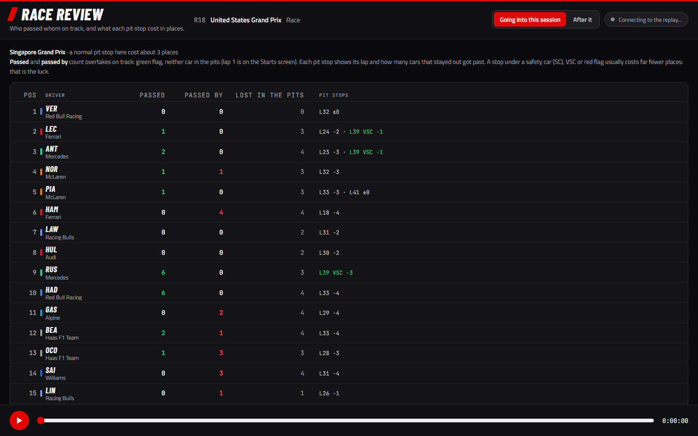
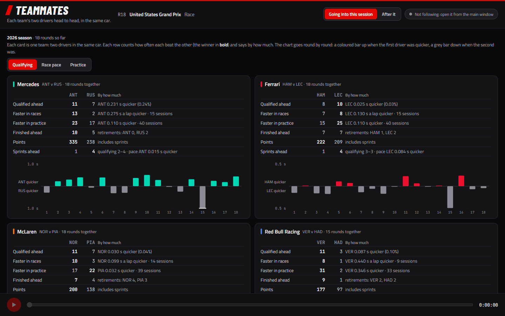
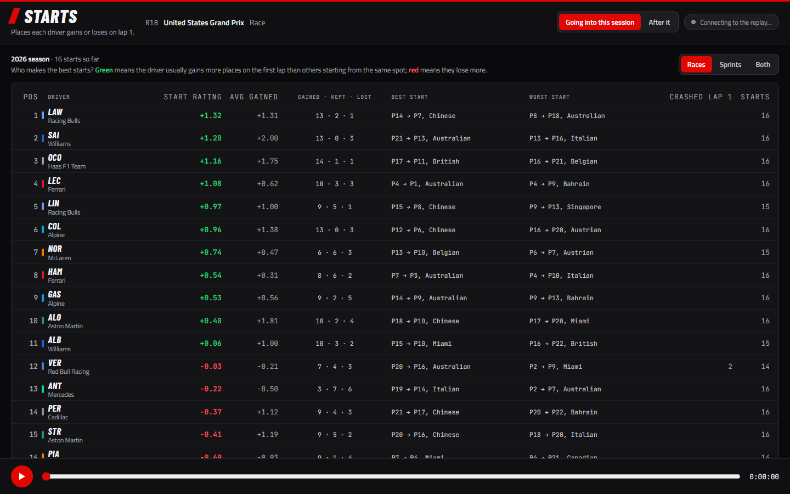
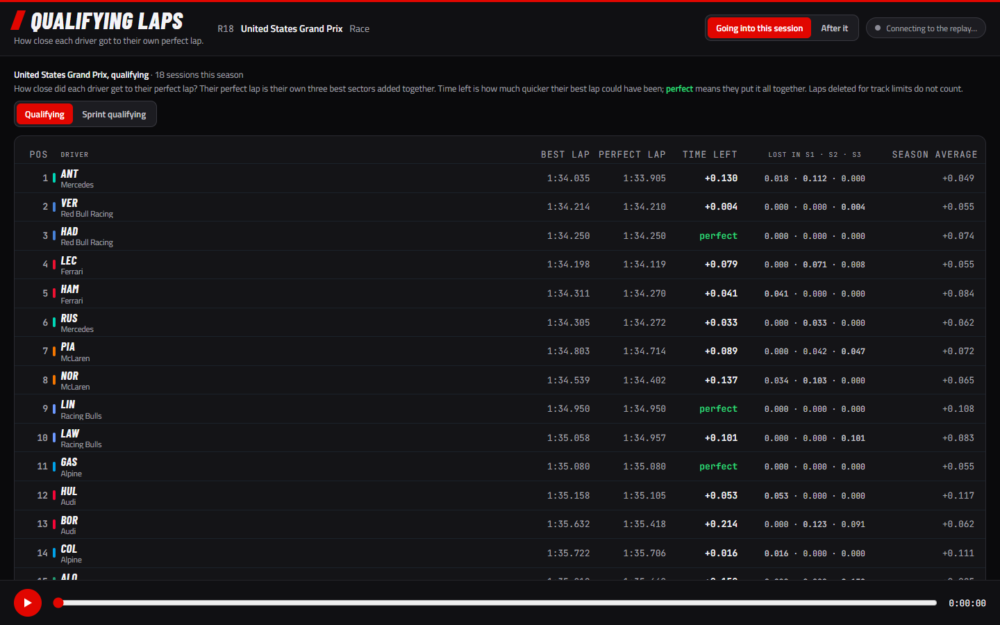

# Racecraft

**An F1 race replay and strategy workbench, built on public timing data.**

Racecraft replays any Formula 1 session since 2023 on a live track map, with every
car's telemetry, the timing tower and race control. It also works out what the
public feed does not show: tyre wear, what a pit stop costs, when each car is best
off stopping, how the race is likely to finish, and how each driver measured up
against their teammate, at the start, in qualifying and in the race.

It runs as a Windows desktop app, or as a local web app in any browser.


> Racecraft is an independent, non-commercial project. It is **not affiliated with
> Formula 1**. See [Data, credits and trademarks](#data-credits-and-trademarks).

---

## Contents

- [What it does](#what-it-does)
- [The screens](#the-screens)
- [How it works](#how-it-works)
- [How accurate it is](#how-accurate-it-is)
- [Getting started](#getting-started)
- [Using the app](#using-the-app)
- [Command line](#command-line)
- [Live timing](#live-timing)
- [Building the Windows installer](#building-the-windows-installer)
- [Configuration](#configuration)
- [Project layout](#project-layout)
- [Development](#development)
- [Security](#security)
- [Limits: what the data cannot tell you](#limits-what-the-data-cannot-tell-you)
- [Data, credits and trademarks](#data-credits-and-trademarks)
- [Copyright and licence](#copyright-and-licence)

---

## What it does

- **Replays any session** from 2023 to now (practice, qualifying, sprint and race)
  with the cars moving on a map drawn from their own GPS positions, at 1x to 30x.
- **Shows what each car is doing**: speed, gear, throttle, brake, DRS (from 2026,
  overtake mode), and the last 30 seconds of it as a trace.
- **Compares two drivers' laps metre by metre**: where each brakes, how much speed
  they carry, where the time is gained.
- **Works out strategy**: what tyre wear and the pit lane cost at each circuit, the
  cheapest plans with and without safety cars, and when each car should stop.
- **Predicts the race and the sprint** from practice, qualifying and recent form,
  as each driver's chance to win, reach the podium and score.
- **Keeps the championships** as they stood at any session of the season, with
  each driver's and team's chance of the title.
- **Reviews the season**: teammate head-to-heads, lap-1 starts, how close each
  driver came to a perfect qualifying lap, and pit-crew speed.
- **Reviews each race**: who passed whom on track, and what every pit stop cost in
  places, so a lucky safety car shows.
- **Explains race control**: every steward's verdict and track message in plain
  words.
- **Follows a session live** from F1's own timing feed, with no subscription.
- **Keeps itself current**: the desktop app fetches the latest race weekends while
  it is open.

Nothing gives away the result: every season screen can be set to *going into this
session* or *after it*, and every model of a past race is fitted only on races
before it.

---

## The screens

A navigation rail runs down the left and a playback bar along the bottom. Every
screen except the replay and settings can pop out into a window of its own (the ↗
button) that follows the main window's clock, so the timing tower can sit on a
second monitor.

### Race

| | |
|---|---|
| **Replay**: the circuit coloured by a followed car's last lap (green flat out, red braking), cards for up to two followed drivers, the timing tower and race control. |  |
| **Timing tower**: every car's gap, interval, last and best lap, sectors in timing colours, tyre and age, stops and penalties. |  |
| **Race trace**: the gap to the leader lap by lap, drawn only up to the lap on the clock. Safety-car laps are shaded. |  |
| **Pedals and speed**: one driver's lap against another's by distance: the time between them, speed, throttle, brake, gear and every brake zone. |  |
| **Race review**: per driver, overtakes made and lost on track, and each pit stop's lap and the places it cost, marked when made under a safety car, VSC or red flag. |  |

### Plan

| | |
|---|---|
| **Strategy**: each car's pit window and most likely stop lap, the undercut watch, a stint map, and the cheapest plans raced against the field. |  |
| **Tyres**: the wear curve for each compound with every car placed on it, and every car's tyre sets through the weekend. |  |
| **Race prediction**: the favourite, podium chances, the full predicted order with each driver's likely range, and after the race the result beside it. |  |

### Control

| | |
|---|---|
| **Stewards**: every race control message explained (what it is, its status, its effect) and the flags and safety cars across the race. |  |

### Season

| | |
|---|---|
| **Standings**: both championships as they stood going into the session or after it, with each driver's and team's chance of the title. |  |
| **Pit crews**: every team's crew ranked by its typical stop against the race's typical stop. |  |
| **Teammates**: each team's two drivers head to head: who qualified ahead, who was faster in races and practice, who finished ahead, and a round-by-round chart of the gap. |  |
| **Starts**: places each driver gains or loses on lap 1, judged against what drivers starting from the same grid slots usually gain. |  |
| **Qualifying laps**: each driver's best lap against their own perfect lap (their three best sectors added together): the time left on the table, and where. |  |

**Settings** holds units, row density, the map's labels and refreshing the data.

---

## How it works

```
 F1 timing feed ──► ingest ──► Parquet lake ──► DuckDB ──► models ──► FastAPI ──► React app
 (historic + live)  (checks)   data/lake/       (queries)   (Python)   (JSON API)   desktop window
                                                                                    or browser
```

- **Ingest** (`racecraft-ingest`) pulls each session through
  [FastF1](https://github.com/theOehrly/Fast-F1): laps, results, telemetry, GPS
  positions, weather, race control and track status. It checks the data and stores
  it as Parquet, one file per table per session, in `data/lake/` (about 1.5 GB for
  2023 to 2026). Sessions F1's archive will not serve without a login are built from
  free sources instead (see [credits](#data-credits-and-trademarks)), into the same
  tables, and the app names the sources beside each session.
- **DuckDB** reads the lake in place: no database server, nothing to keep in sync.
- **The models** (Python, numpy, pandas, scipy) fit tyre wear, pace and pit loss
  from earlier races, simulate races car by car, and predict results.
- **The API** (FastAPI) serves any instant of a session and every model's answer.
- **The interface** (React and TypeScript, built with Vite) draws it, buffering the
  map and telemetry ahead of the clock so playback stays smooth.
- **The desktop app** wraps the same thing in its own window (pywebview on Windows'
  WebView2), with no terminal and no port to remember.

The full working record, with the measurements behind every number, is in
[docs/TECHNICAL.md](docs/TECHNICAL.md).

---

## How accurate it is

Every figure the app shows either comes straight from the timing data or was
checked against real races before it was kept. A measure that did not hold up was
left out, and the app says when something is an estimate.

**Race prediction**, replayed over every race since 2023, each predicted only from
what was known before it. Each 2023 to 2025 season is predicted with weights fitted
on the other two; 2026, a new rulebook, was never trained on.

| | Finishing order (rank correlation) | Win chances (Brier, lower is better) |
|---|---|---|
| 2023 to 2025, 69 races | **0.69** model, 0.66 grid | **0.54** model, 0.63 grid |
| 2026, 18 races | **0.69** model, 0.66 grid | **0.45** model, 0.47 grid |

It beats "everyone finishes where they started" every season, by a small margin:
the grid already holds most of what is knowable on Saturday night. Over 2023 to 2025
the gain is statistically real (Wilcoxon signed-rank, p < 0.001); 18 races of 2026
are too few to prove it either way.

**Sprint prediction** ties the grid on order (a sprint is short and nobody stops)
but gives more honest chances: Brier 0.53 against 0.59 over 2023 to 2025.

**Title odds**, replayed from every round of 2023 to 2025, gave the eventual champion
a 66% chance on average, against 49% from the points alone.

**Pit crews**: a team's figure in one half of a season predicts the other half
closely (split-half correlation 0.80 to 0.91), so the order is the crews', not chance.

**Race review**: a green-flag stop costs a median 3 places, one under a safety car
0 (69% of them lose none), so the places column shows safety-car luck reliably.
Checked and **left out** because they did not hold up: lap-time consistency (it
changes more from race to race than between drivers), safety-car savings in seconds
(too noisy), and "pitted on the wrong lap" (an opinion with nothing to check it
against).

**Qualifying laps**: across 2026, the median driver leaves 0.04 s on the table; laps
deleted for track limits do not count.

---

## Getting started

### What you need

| | Version | Check with |
|---|---|---|
| Windows 10 or 11 | for the desktop app; the browser mode also runs on macOS and Linux | |
| Python | 3.11 or newer | `python --version` |
| Node.js | 20.19+ or 22.12+ | `node --version` |
| Git | any | `git --version` |
| Disk | about 3 GB for 2023 to 2026, less for fewer seasons | |

### 1. Get the code

```powershell
git clone https://github.com/Adityavalaki/racecraft.git
cd racecraft
```

### 2. Install the Python side

```powershell
python -m venv .venv
.venv\Scripts\python -m pip install -e ".[dev,app]"
```

On macOS or Linux, leave out `app` (the desktop window is Windows-only):

```sh
python3 -m venv .venv
.venv/bin/python -m pip install -e ".[dev]"
```

### 3. Build the interface

```powershell
cd web
npm install
npm run build
cd ..
```

### 4. Get some race data

The data folder starts empty. Either let the app fetch the latest race weekends by
itself (step 5), or fetch what you want:

```powershell
.venv\Scripts\racecraft-ingest --season 2025 --rounds 4 --sessions FP2 Q R   # one weekend, quickly
.venv\Scripts\racecraft-ingest --season 2025 --prune-cache                   # a whole season
.venv\Scripts\racecraft-ingest --prune-cache                                 # everything since 2023
```

A full backfill takes hours. That is expected: F1's servers allow a limited number
of requests an hour, and the command waits for its budget rather than risk being
blocked. Run it again and it resumes. On Windows, `scripts\backfill.ps1` runs it
while keeping the machine awake. Always pass `--prune-cache`, or the download cache
grows by several gigabytes.

### 5. Run it

**As a desktop app (Windows):**

```powershell
.venv\Scripts\racecraft --install-shortcuts     # adds Racecraft to the Desktop and Start menu
```

Then open **Racecraft**. It fetches the latest race weekends shortly after launch and
every fifteen minutes while open, and stops completely when closed.

**In a browser (any system):**

```powershell
.venv\Scripts\racecraft-serve          # then open http://127.0.0.1:8000
```

### 6. Check it works

```powershell
.venv\Scripts\python -m pytest -m "not network"     # Python tests, offline
cd web; npm test; cd ..                             # interface tests
```

Tests marked `realdata` use your downloaded data and skip themselves when a session
they need is missing.

### Troubleshooting

| Problem | Fix |
|---|---|
| The session list is empty | No data yet: press **Refresh data** at the foot of the rail, or run `racecraft-ingest`. |
| `racecraft` is not recognised | Use the full path, `.venv\Scripts\racecraft`, or activate the environment first. |
| The window is blank | Build the interface (step 3); check `data/logs/`. |
| Ingest is "waiting" for a long time | It is respecting F1's rate limit. Leave it running. |
| A session shows no track map | Some sessions have no position data in the feed; the app says so. |

---

## Using the app

- **Pick a session** at the top, **play** with Space, and **scrub** on the timeline,
  which is coloured by flags and safety cars.
- **Follow a driver** by clicking them in the timing tower (up to two).
- **Pop out** any screen with ↗; it stays in step with the main window.
- On season screens, choose **Going into this session** (no spoilers) or **After it**.

| Key | Does |
|---|---|
| Space | Play or pause |
| ← → | Back or forward 5 s (with Shift, 30 s) |
| ↑ ↓ | Faster or slower |
| Home | Back to the start |
| L | Driver names on the map |
| D | DRS zones on the map (2026: overtake rings) |

---

## Command line

| Command | What it does |
|---|---|
| `racecraft` | The desktop app (`--install-shortcuts`, `--uninstall-shortcuts`). |
| `racecraft-serve` | The API and interface on `http://127.0.0.1:8000` (`--port`, `--reload`). |
| `racecraft-ingest` | Fetch sessions (`--season`, `--rounds`, `--sessions`, `--prune-cache`, `--watch`). |
| `racecraft-analyse pace` | Tyre wear and fuel effect, per season. |
| `racecraft-analyse circuits` | Pit loss and safety-car risk at every circuit. |
| `racecraft-analyse strategy Baku` | The cheapest plans, in seconds. |
| `racecraft-analyse race Baku --grid 8` | Plans for one car, raced against the field, in places. |
| `racecraft-analyse predict 2025_04_Q` | The weekend's race, predicted from before it started. |
| `racecraft-analyse predict-backtest` | Every race since 2023 predicted and scored against the grid. |
| `racecraft-analyse title 2026` | Each driver's and team's chance of the championship. |
| `racecraft-live record` / `status` / `read` | Record F1's live timing feed, and read it back. |

Session keys look like `2025_04_R`: season, round, session (`FP1`, `FP2`, `FP3`,
`SQ`, `S`, `Q`, `R`).

---

## Live timing

```powershell
.venv\Scripts\racecraft-live record --name my-race    # start before the session, leave running
.venv\Scripts\racecraft-serve                         # then pick LIVE in the session list
```

Racecraft records F1's own timing stream and reads it into the same screens as a
past session. No F1 TV subscription is needed. Live covers the timing side (tower,
trace, tyres, strategy); there is no track map until the session is fetched
afterwards.

---

## Building the Windows installer

```powershell
powershell -ExecutionPolicy Bypass -File packaging\build_app.ps1     # dist\Racecraft\Racecraft.exe
powershell -ExecutionPolicy Bypass -File packaging\build_msix.ps1    # dist\Racecraft.msix, signed
```

The frozen app runs on any Windows 10 or 11 machine without Python. Signing needs
a certificate you make once with `packaging\make_cert.ps1`; see
[packaging/README.md](packaging/README.md). Installed, the app keeps its data in
`%LOCALAPPDATA%\Racecraft`.

---

## Configuration

All optional, as environment variables:

| Variable | Default | What it sets |
|---|---|---|
| `RACECRAFT_DATA_DIR` | `data/` in a checkout, `%LOCALAPPDATA%\Racecraft` when installed | Everything Racecraft writes |
| `RACECRAFT_LAKE_DIR` | `<data dir>/lake` | The race data |
| `RACECRAFT_FASTF1_CACHE` | `<data dir>/fastf1_cache` | FastF1's download cache |
| `RACECRAFT_ALLOWED_HOSTS` | none | Extra addresses the server answers to; see [Security](#security) |

---

## Project layout

```
racecraft/
├── src/racecraft/
│   ├── ingest/      fetching sessions, checking them, syncing recent weekends
│   ├── store/       the Parquet lake and DuckDB over it
│   ├── live/        recording and reading F1's live timing feed
│   ├── model/       pace, circuits, strategy, the race simulator, predictions,
│   │                standings, teammates, starts, qualifying laps, race review
│   ├── api/         the FastAPI server
│   └── app/         the desktop app: window, single instance, auto-sync, shortcuts
├── web/src/         the React interface: screens, panels, styles
├── tests/           Python tests (offline; `realdata` ones use your data)
├── packaging/       building the desktop app and the MSIX installer
├── scripts/         backfill helper and the icon generator
├── docs/            TECHNICAL.md and the screenshots
└── data/            (not in git) your race data, logs and caches
```

---

## Development

```powershell
.venv\Scripts\racecraft-serve --reload    # the API, restarting on change, on :8000
cd web; npm run dev                       # the interface with hot reload, on :5173
```

Before committing:

```powershell
.venv\Scripts\python -m pytest -m "not network"
cd web; npm test; npm run build; npm audit
```

House rules: a model never sees the race it is asked about; every number shown can
be traced to the data or a check; anything estimated says so on screen.

---

## Security

Racecraft has **no accounts, passwords or API keys**, and stores **no personal
data**: everything it keeps is public timing data. The server is meant for your own
computer and is built to stay that way:

- **It listens on 127.0.0.1 only**, so other devices cannot reach it.
- **It answers only to this computer's names** (`127.0.0.1`, `localhost`), so a
  website pointing its own domain at your machine (DNS rebinding) is refused.
- **Only its own pages can change anything**: a data refresh or live attach sent from
  another website is refused.
- **Strict security headers** on every response: a content security policy allowing
  only the app's own scripts, and protection against framing and type sniffing. The
  page loads nothing from other sites; the fonts are bundled.
- **Input is checked**: session keys before they reach a query, and live recordings
  must sit in the live folder.
- **The API's documentation pages are switched off.**
- **Dependencies are kept patched**: known advisories are pinned out in
  `pyproject.toml`, and `npm audit` is part of the checks before every commit.

To use it from another device on purpose, start it with
`racecraft-serve --host 0.0.0.0` and name the address in `RACECRAFT_ALLOWED_HOSTS`.
There is no login, so do this only on a network you trust.

The installer's signing certificate is a private key: it is ignored by git and has
never been committed. Make your own with `packaging\make_cert.ps1`.

**Found a vulnerability?** Please report it privately, as described in
[SECURITY.md](SECURITY.md), rather than in a public issue.

---

## Limits: what the data cannot tell you

- **The brake is on or off.** The public feed has no brake pressure, tyre
  temperatures, fuel or remaining sets, so nothing here pretends to show them.
- **Positions are about four samples a second**, smoothed between samples. The
  safety car has no position in the feed; it is drawn ahead of the leader and
  labelled as simulated.
- **Practice fuel loads are unknown**, so long runs are the weakest prediction
  signal and are weighted accordingly.
- **What chance decides is left to chance**: first-lap incidents, rain and team
  orders are not modelled.
- **The models are fitted on 2023 onwards**, so the first race at a new circuit
  borrows typical values and says so.

---

## Data, credits and trademarks

- **Timing data** comes from Formula 1's public feeds through
  [FastF1](https://github.com/theOehrly/Fast-F1) (MIT). Use it in line with F1's
  terms. Racecraft does not redistribute any data: the `data/` folder is never
  committed, and each user fetches their own.
- **Sessions F1's archive will not serve** come from free sources, with thanks:
  [OpenF1](https://openf1.org) (free tier for personal, non-commercial use),
  the [Jolpica F1 API](https://github.com/jolpica/jolpica-f1) and
  [TracingInsights](https://github.com/TracingInsights) (Apache-2.0).
- **Championship history** for testing the title odds:
  [f1db](https://github.com/f1db/f1db) (CC BY 4.0).
- **Weather**: [weather data by Open-Meteo.com](https://open-meteo.com) (CC BY 4.0).
- **Team radio** is played straight from Formula 1's own server; Racecraft stores
  no audio.
- **Fonts**: Titillium Web, Barlow Condensed and JetBrains Mono (SIL Open Font
  License), bundled through Fontsource.
- **Built with** FastF1, DuckDB, pandas, numpy, scipy, FastAPI, React, Vite and
  pywebview, each under its own licence.

**Trademarks.** F1, FORMULA 1, the F1 logo and related marks are trademarks of
Formula One Licensing B.V. Team and driver names are used only to identify them.
Racecraft is an independent, non-commercial project, **not affiliated with,
endorsed by or connected to** Formula 1, the FIA or any team.

---

## Copyright and licence

Copyright © 2026 Aditya Valaki. All rights reserved.

The source is published so it can be read and reviewed. It is **not** open source:
copying, modifying, redistributing or using it commercially needs written
permission. See [LICENSE](LICENSE) for the full terms. Third-party libraries, data
and fonts stay under their own licences, listed above.
