# Racecraft

**Understand why a Formula 1 race went the way it did, and see how it is likely to go next.**

Racecraft is a free Windows app for F1 fans. It replays every session since 2023 with
the cars on a live track map, and works out what the broadcast and the timing screens
don't show you: what each pit stop really cost, how fast each tyre wears, which driver
is quicker through which corner, and who is most likely to win on Sunday. Every
prediction it makes is scored against what then happened, and the scores are below.

**[Download for Windows](https://github.com/Adityavalaki/racecraft/releases/latest)** ·
[How accurate is it?](#how-accurate-is-it) · [Install in three steps](#install) ·
[Questions](#questions)

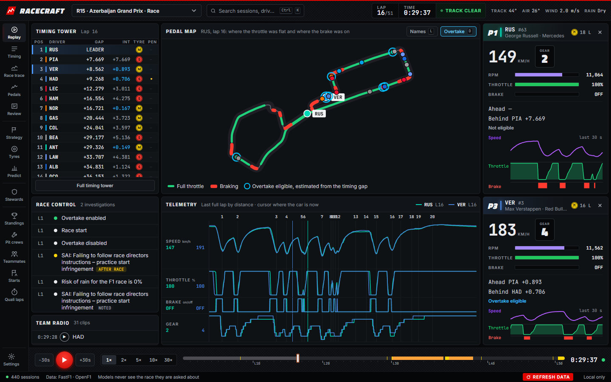

> Racecraft is an independent, non-commercial project. It is **not affiliated with
> Formula 1**, the FIA or any team. Predictions are estimates, not advice.

---

## Contents

- [Who it is for](#who-it-is-for)
- [What you can find out](#what-you-can-find-out)
- [The screens](#the-screens)
- [How accurate is it?](#how-accurate-is-it)
- [Install](#install)
- [Questions](#questions)
- [What it cannot tell you](#what-it-cannot-tell-you)
- [Privacy and security](#privacy-and-security)
- [For developers](#for-developers)
- [Data, credits and trademarks](#data-credits-and-trademarks)
- [Copyright and licence](#copyright-and-licence)

---

## Who it is for

- **Fans who want the "why".** A driver lost three places in the pit stops, or gained
  five on lap 1: Racecraft shows where, and in plain words.
- **Strategy followers.** See when each car is best off stopping, what tyres it has
  left, and how a safety car changes the picture, lap by lap.
- **Anyone who likes a prediction they can check.** The race and title chances come
  from simulating the race thousands of times, and the app keeps score against the
  real results.
- **People who rewatch races.** Replay any session at up to 30x, pause anywhere, and
  nothing shows you a result from later than the moment you are watching.

You don't need to code, sign up or pay. You need a Windows 10 or 11 PC and an
internet connection for the first download of race data.

---

## What you can find out

| You want to know | Open | What it shows |
|---|---|---|
| What happened at any moment of a race | **Replay** | Every car on the map, the timing tower, race control, and two drivers' speed, throttle and brake |
| Who gained and lost places, and why | **Race review** | Every pass on track, and the places each pit stop won or cost, with safety-car luck marked |
| When a car should pit, and what it would cost | **Strategy** | The rest of each car's race shaded by what a stop on each lap costs, and where it would rejoin |
| How fast each tyre wears | **Tyres** | A wear chart per compound with every car on it, and every car's tyre sets through the weekend |
| Where one driver is faster than another | **Pedals and speed** | Two laps compared metre by metre, corner by corner: braking points, minimum speeds, time gained |
| Who will win on Sunday | **Race prediction** | Each driver's chance to win, reach the podium and score, made from Friday and Saturday only |
| Who will win the championship | **Standings** | Both tables at any point of the season, with each driver's and team's chance of the title |
| How the gaps opened and closed | **Race trace** | Positions lap by lap, the gaps at any lap, and each driver's race pace |
| Which teammate is really quicker | **Teammates** | Qualifying, race pace and results head to head, round by round |
| Who makes the best starts | **Starts** | Places gained on lap 1, against what is usual from that grid slot |
| Which crews are quickest | **Pit crews** | Every team's stops across the season |
| What the stewards decided | **Stewards** | Every penalty and investigation, explained, at the moment it happened |

Season screens can be set to **going into this session** or **after it**, so you can
catch up on a race without seeing the result first.

---

## The screens

### Race

| | |
|---|---|
| **Replay**: a pit wall. The timing tower, the circuit coloured by a followed car's last lap (green flat out, red braking), a dashboard for each of two followed drivers (speed, gear, revs, throttle, brake, the gaps either side), race control, and the followed drivers' last laps, channel by channel. |  |
| **Timing tower**: every car's gap, interval, last and best lap, sectors in timing colours, tyre and age, stops and penalties; beside it the field on a ring, one turn a lap, each car a tick that moves with the replay. | 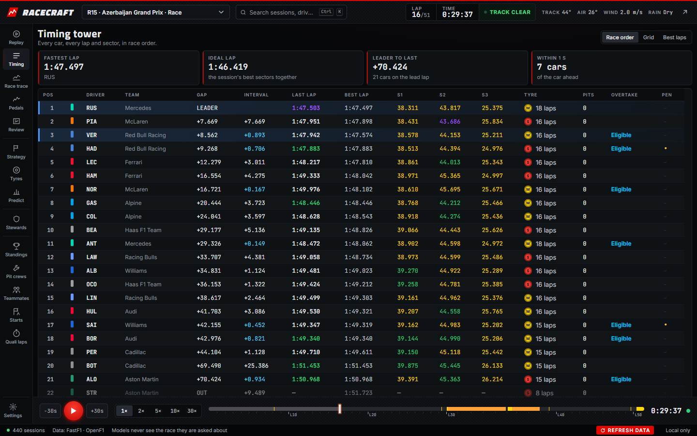 |
| **Race trace**: positions lap by lap, with safety-car laps shaded and every pit stop marked; the gap to the leader and the interval as a bar per driver at any lap, with a lap slider; and each driver's race pace as a box of their green-flag laps. | 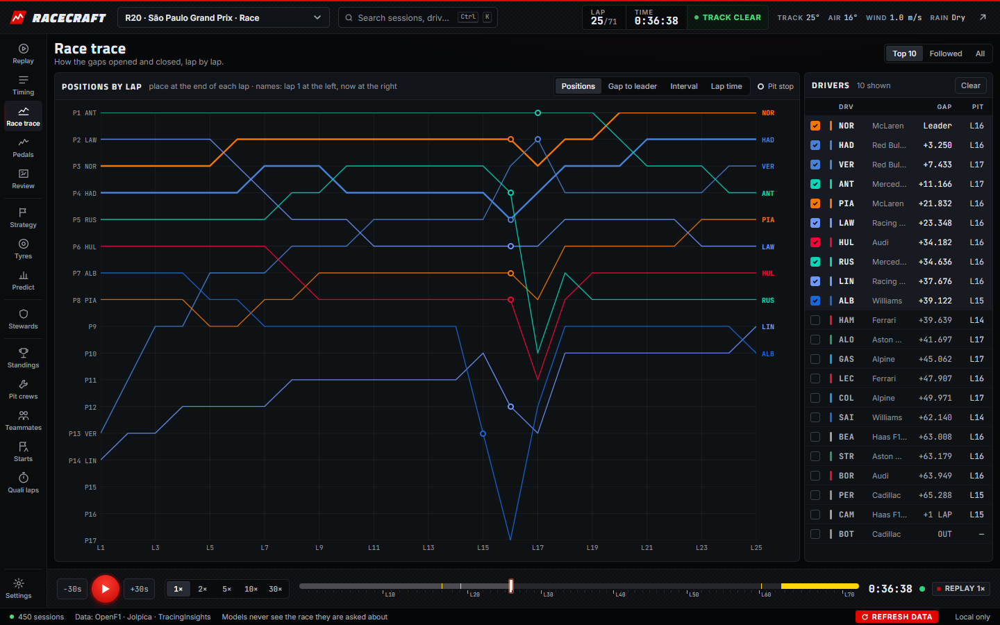 |
| **Pedals and speed**: one driver's lap against another's: the headline figures, the time between them shaded by who is ahead, speed, a pedal row per driver, and every corner with each driver's slowest point, the time gained or lost there, and where they braked or lifted. | 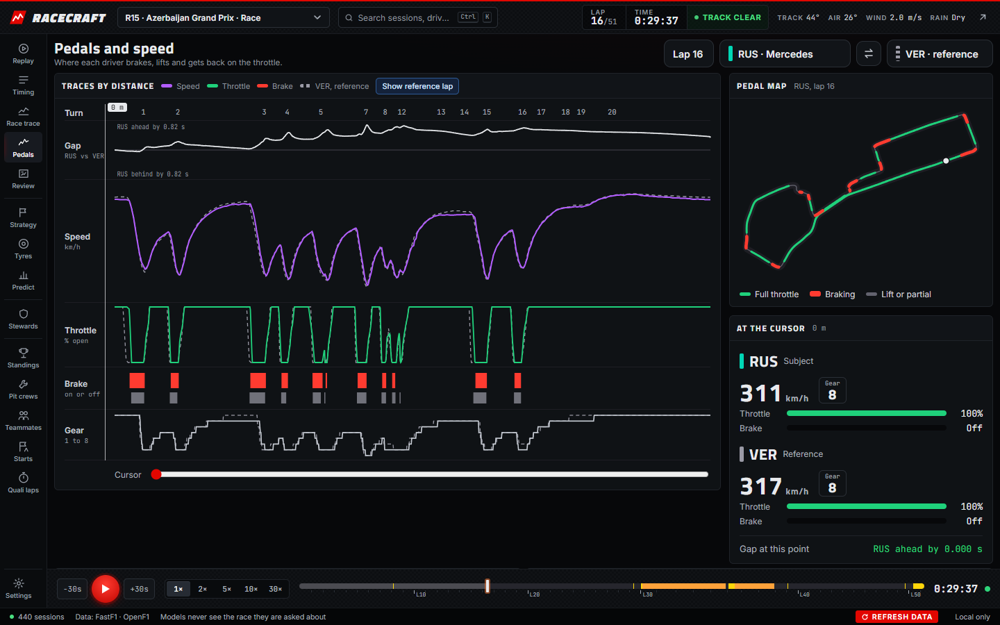 |
| **Race review**: per driver, overtakes made and lost on track, and each pit stop's lap and the places it cost, marked when made under a safety car, VSC or red flag. Click a driver to read their stops as sentences. | 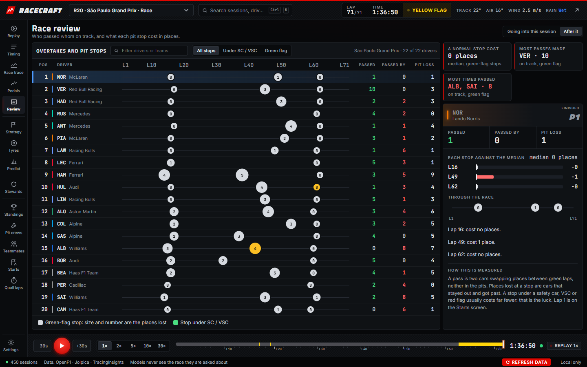 |

### Plan

| | |
|---|---|
| **Strategy**: each car's stints so far and the rest of its race shaded by what a stop on each lap would cost, with the cheapest lap marked; where it would rejoin among the cars around it; and the cheapest plans raced against the field. | 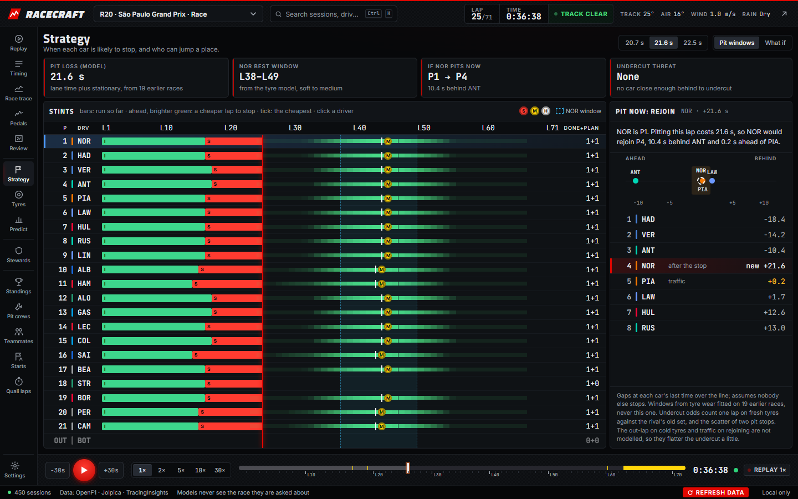 |
| **Tyres**: a wear chart for each compound with every car placed on it at its tyres' age, and every car's tyre sets through the weekend. | 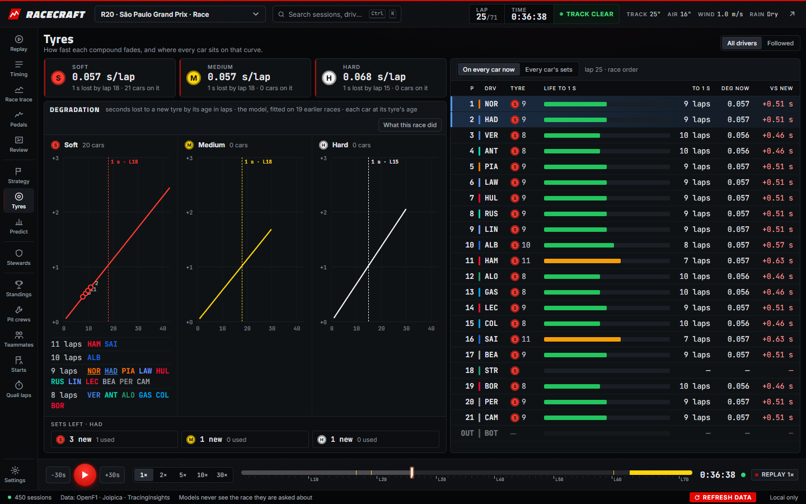 |
| **Race prediction**: the favourite, podium chances, the full predicted order with each driver's likely range, and after the race the result beside it. | 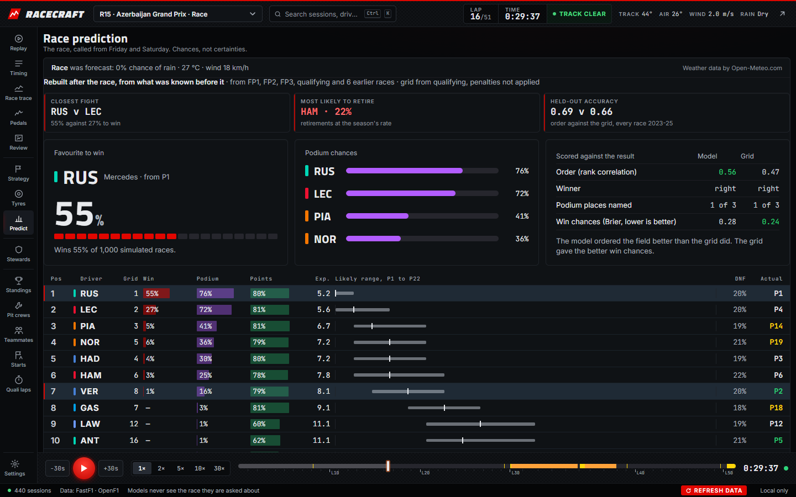 |

### Control

| | |
|---|---|
| **Stewards**: every race control message explained (what it is, its status, its effect) and the flags and safety cars across the race. | 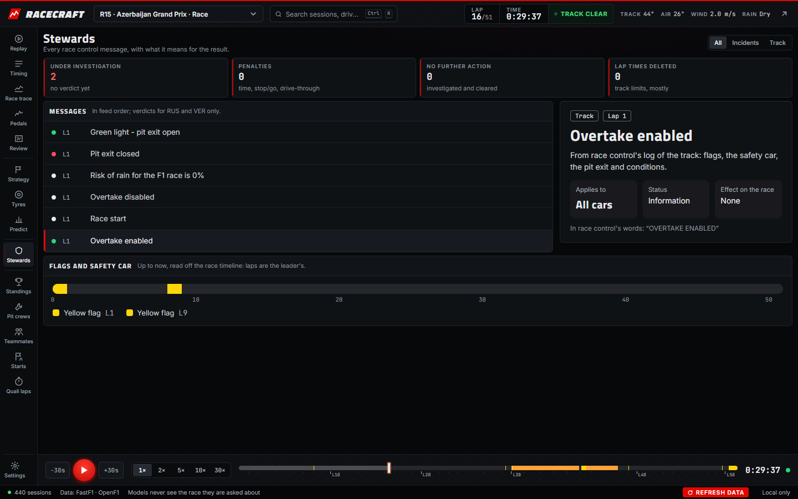 |

### Season

| | |
|---|---|
| **Standings**: both championships as they stood going into the session or after it, with each driver's and team's chance of the title. | 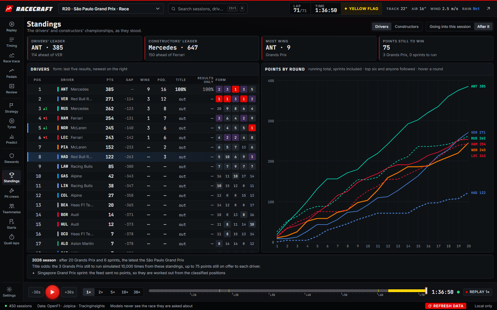 |
| **Pit crews**: every team's crew ranked by its typical stop against the race's typical stop, each as a box of all its stops this season. | 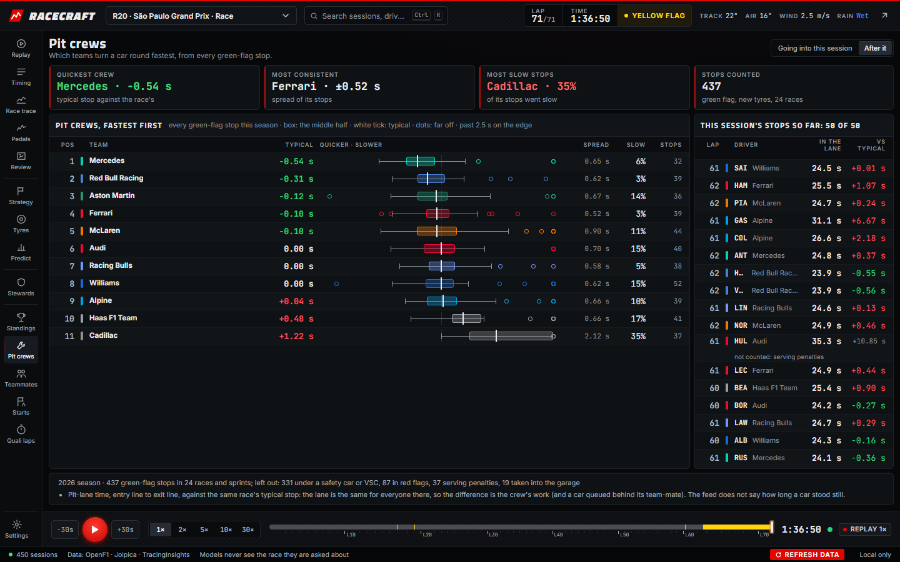 |
| **Teammates**: each team's two drivers head to head: who qualified ahead, who was faster in races and practice, who finished ahead, and a round-by-round chart of the gap. | 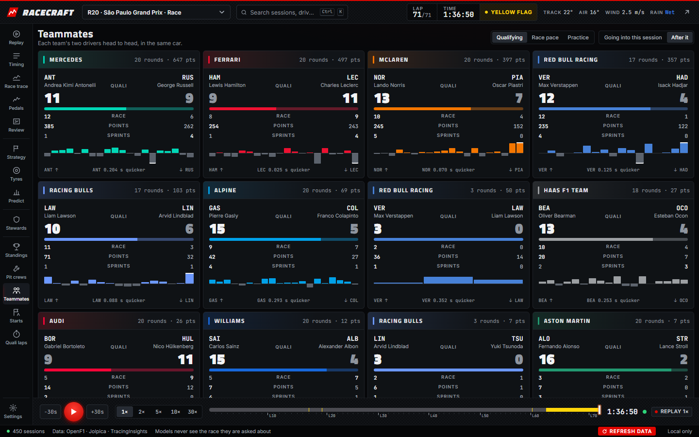 |
| **Starts**: an arrow per driver from grid slot to place after lap 1, judged against what drivers starting from the same grid slots usually gain. | 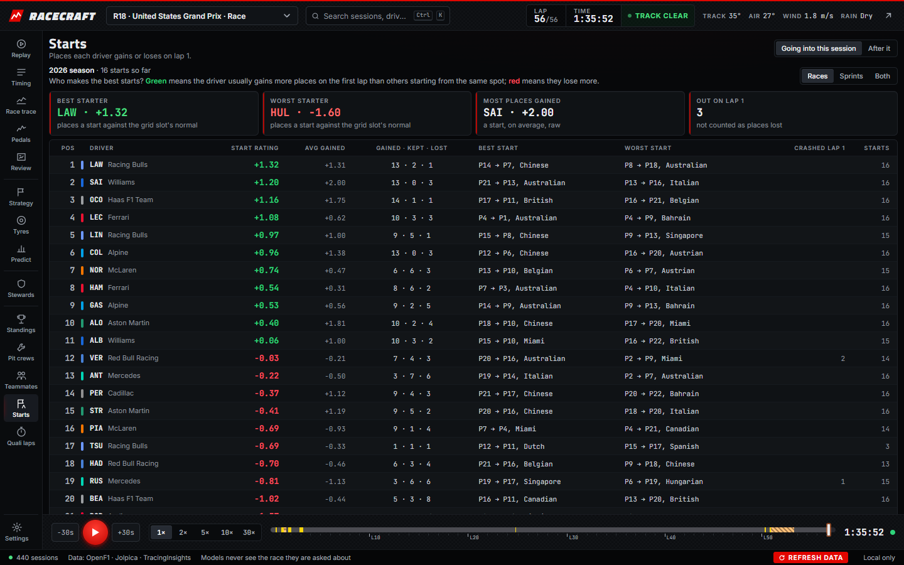 |
| **Qualifying laps**: each driver's best lap against their own perfect lap (their three best sectors added together): the time left on the table, and where. | 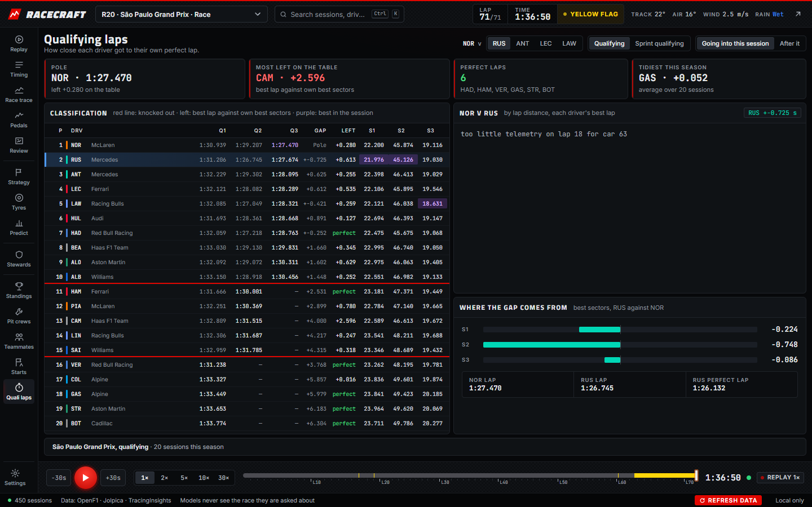 |

A session bar runs across the top (session, lap, race time, track status, weather,
and a search with Ctrl K). Every screen except the replay and settings can pop out
into its own window that follows the main clock, so the timing tower can sit on a
second monitor.

---

## How accurate is it?

Every number Racecraft shows either comes straight from the timing data or was
checked against real races before it was kept. Ideas that did not hold up were left
out, and the [full record](docs/TECHNICAL.md) includes the ones that failed.

**How the predictions are tested.** Each past race is predicted again using only what
was known before it started, then scored against what happened. Each season from 2023
to 2025 is predicted with settings measured on the other two seasons, and **2026 was
never used to tune anything**: it is the honest test. Every score is compared with a
simple rule that is hard to beat, *everyone finishes where they started*.

### Race prediction

| Measured on | Finishing order | Winner named | Podium places named | Win chances, honesty |
|---|---|---|---|---|
| 2023 to 2025, 69 races | **0.69** (grid 0.66) | **62%** (pole 58%) | **2.09 of 3** (grid 2.06) | **0.54** (grid 0.63) |
| 2026, 20 races, never tuned on | **0.69** (grid 0.64) | **70%** (pole 70%) | **1.85 of 3** (grid 1.80) | **0.48** (grid 0.50) |

How to read it:

- **Finishing order** is a rank correlation: 1 would be the exact order, 0 a random
  guess. 0.69 means the predicted order gets most drivers close to where they finish.
- **Win chances, honesty** is the Brier score, lower is better. It checks that when the
  app says 30%, that driver wins about 30% of the time. Over 2023 to 2025 the app's
  chances are clearly better than the grid's, and the gain is statistically real
  (Wilcoxon signed-rank, p < 0.001 over 69 races).
- **What it means for you**: the prediction is a small, real edge over "the grid
  decides", not a crystal ball. Saturday's grid already holds most of what can be
  known; the app adds race pace, tyre wear, pit stops, overtaking and safety cars.
  On naming the winner it ties pole position.

### Everything else

| Model | Result | Compared with |
|---|---|---|
| **Sprint prediction**, 2023 to 2025 | Win chances 0.53 (lower is better); order 0.76 | Grid 0.59; 0.75 |
| **Title odds**, every round of 2023 to 2025 | The eventual champion's average chance: **66%** | 49% from the points table alone |
| **Title odds**, the same test on 76 seasons since 1950 | **55%** for the eventual champion | 49% from the points alone |
| **Title odds**, first quarter of the 2023 to 2025 seasons | **55%** for the eventual champion | 10% from the points alone |
| **Race simulator**, 35 races of 2025 and 2026 | Each car's finish within **3.2 places** on average | 3.7 places from the grid |
| **Tyre sets left before the race**, 90 races | **97.2%** of 4,494 sets raced were tracked correctly | |
| **Pit crews** | A team's first half-season predicts its second half closely (0.80 to 0.91) | |
| **Timing data**, every race and sprint | 104 of 107 race times match the official time within 0.33 s | |

### Where it is weak, measured the same way

- **Strategy suggests stopping later than teams do**: its cheapest first stop is on
  average about 5 laps later than the field's real first stop (36 dry races). Use
  the cost strip, which shows how little a few laps either way usually cost, rather
  than one "best" lap.
- **Late in a season, title odds are no better than the points table**: in the last
  quarter of the 2023 to 2025 seasons the points alone gave the eventual champion 87%,
  the app 86%.
- **The first race at a new circuit** has no history to learn from: tyre wear and pit
  loss borrow typical values, and the app says so.

---

## Install

1. **Download** `Racecraft-windows-x64.zip` from the
   [latest release](https://github.com/Adityavalaki/racecraft/releases/latest)
   (about 141 MB).
2. **Unzip it**: right-click the file, then **Extract All**, to any folder.
3. **Open `Racecraft.exe`** in that folder.

Windows will probably say *"Windows protected your PC"*, because the app is not yet
signed with a paid certificate. Choose **More info**, then **Run anyway**. The source
is public if you would rather check it first.

**First run.** The app holds no race data until you open it. It asks how much you
want and fetches it from free public sources, newest race first, so you can start
watching while the rest arrives:

| Your choice | Time | Disk space |
|---|---|---|
| The last 5 races | about 1.5 hours | 100 MB |
| The latest whole season | up to 6.5 hours | 450 MB |
| Everything since 2023 | about 24 hours | 1.6 GB |

It only downloads while Racecraft is open and carries on where it stopped. After that
it fetches each new race weekend by itself. You can change your choice in Settings.

**Needs**: Windows 10 or 11, 64-bit; an internet connection for the data.

---

## Questions

**Is it free?** Yes. No sign-up, no ads, no paid tier.

**Does it work on Mac or Linux?** Not as an app. It can run in a browser on any
system from the source code: see [For developers](#for-developers).

**Where is my data kept, and how do I remove it?** Race data, caches and logs are in
`%LOCALAPPDATA%\Racecraft`. To uninstall, delete the folder you unzipped and that one.

**Why do the predictions sometimes miss badly?** First-lap crashes, rain and team
orders are not predictable from Friday and Saturday, and the app does not pretend
they are. Its percentages already include that chance.

**Can I watch a session live?** Not from the download yet. Following a session live
needs the live recorder, which runs from the source code (see
[For developers](#for-developers)). Every session appears in the app once it has been
fetched, usually within a few hours of it ending.

**I found a wrong number.** Please
[open an issue](https://github.com/Adityavalaki/racecraft/issues) with the session and
the screen. Data errors are usually easy to check.

---

## What it cannot tell you

- **The brake is on or off.** The public feed has no brake pressure, tyre
  temperatures, fuel or engine modes, so nothing here pretends to show them.
- **Positions are about four samples a second**, smoothed between samples. The
  safety car has no position in the feed; it is drawn ahead of the leader and
  labelled as simulated.
- **Practice fuel loads are unknown**, so practice long runs are the weakest
  prediction signal and are weighted accordingly.
- **What chance decides is left to chance**: first-lap incidents, rain and team
  orders are not modelled, and the percentages include them as uncertainty.

---

## Privacy and security

Racecraft has **no accounts, passwords or API keys**, and stores **no personal
data**: everything it keeps is public timing data, on your own disk. It sends
nothing about you anywhere.

The app runs a small server that only your own computer can reach. It listens on
127.0.0.1 only, answers only to this computer's own names, refuses changes sent from
any other website, and serves strict security headers: the page loads nothing from
other sites.

**Found a vulnerability?** Please report it privately, as described in
[SECURITY.md](SECURITY.md), rather than in a public issue.

---

## For developers

<details>
<summary><b>How it works</b></summary>

```
 F1 timing feed ──► ingest ──► Parquet lake ──► DuckDB ──► models ──► FastAPI ──► React app
 (historic + live)  (checks)   data/lake/       (queries)   (Python)   (JSON API)   desktop window
                                                                                    or browser
```

- **Ingest** (`racecraft-ingest`) pulls each session through
  [FastF1](https://github.com/theOehrly/Fast-F1): laps, results, telemetry, GPS
  positions, weather, race control and track status. It checks the data and stores
  it as Parquet, one file per table per session, in `data/lake/`. Sessions F1's
  archive will not serve without a login are built from free sources instead, into
  the same tables, and the app names the sources beside each session.
- **DuckDB** reads the lake in place: no database server.
- **The models** (Python, numpy, pandas, scipy) fit tyre wear, pace and pit loss from
  earlier races, simulate races car by car, and predict results. A model never sees
  the race it is asked about.
- **The API** (FastAPI) serves any instant of a session and every model's answer.
- **The interface** (React and TypeScript, built with Vite) draws it.
- **The desktop app** wraps it in its own window (pywebview on WebView2).

The full working record, with the measurements behind every number, is in
[docs/TECHNICAL.md](docs/TECHNICAL.md).

</details>

<details>
<summary><b>Run from source</b> (Windows, macOS or Linux)</summary>

You need Python 3.11+, Node.js 20.19+ or 22.12+, and Git.

```powershell
git clone https://github.com/Adityavalaki/racecraft.git
cd racecraft
python -m venv .venv
.venv\Scripts\python -m pip install -e ".[dev,app]"     # macOS/Linux: .venv/bin/python -m pip install -e ".[dev]"
cd web; npm install; npm run build; cd ..
```

Then either open the desktop app (Windows) or serve it to a browser (any system):

```powershell
.venv\Scripts\racecraft --install-shortcuts     # adds Racecraft to the Desktop and Start menu
.venv\Scripts\racecraft-serve                   # or open http://127.0.0.1:8000
```

Fetch data from the app's first-run choice, or by hand:

```powershell
.venv\Scripts\racecraft-ingest --season 2025 --rounds 4 --sessions FP2 Q R   # one weekend
.venv\Scripts\racecraft-ingest --season 2025 --prune-cache                   # a whole season
```

A full backfill takes hours: F1's servers allow a limited number of requests an hour,
and ingest waits for its budget rather than risk being blocked. Run it again and it
resumes. Always pass `--prune-cache`, or the download cache grows by gigabytes.

| Problem | Fix |
|---|---|
| The session list is empty | No data yet: choose how much to download when asked, or run `racecraft-ingest`. |
| `racecraft` is not recognised | Use the full path, `.venv\Scripts\racecraft`. |
| The window is blank | Build the interface (`npm run build` in `web`); check `data/logs/`. |
| Ingest is "waiting" for a long time | It is respecting F1's rate limit. Leave it running. |

</details>

<details>
<summary><b>Command line</b></summary>

| Command | What it does |
|---|---|
| `racecraft` | The desktop app (`--install-shortcuts`, `--uninstall-shortcuts`). |
| `racecraft-serve` | The API and interface on `http://127.0.0.1:8000` (`--port`, `--reload`). |
| `racecraft-ingest` | Fetch sessions (`--season`, `--rounds`, `--sessions`, `--prune-cache`, `--watch`). |
| `racecraft-analyse pace` | Tyre wear and fuel effect, per season. |
| `racecraft-analyse circuits` | Pit loss and safety-car risk at every circuit. |
| `racecraft-analyse strategy Baku` | The cheapest plans, in seconds. |
| `racecraft-analyse race Baku --grid 8` | Plans for one car, raced against the field, in places. |
| `racecraft-analyse predict 2025_04_Q` | The weekend's race, predicted from before it started. |
| `racecraft-analyse predict-backtest` | Every race since 2023 predicted and scored against the grid: the table above. |
| `racecraft-analyse title-backtest` | The title odds replayed from every round. |
| `racecraft-live record` / `status` / `read` | Record F1's live timing feed, and read it back. |

Session keys look like `2025_04_R`: season, round, session (`FP1`, `FP2`, `FP3`,
`SQ`, `S`, `Q`, `R`).

Live: start `racecraft-live record --name my-race` before the session and leave it
running, then pick LIVE in the session list.

</details>

<details>
<summary><b>Tests, building the app, configuration and layout</b></summary>

```powershell
.venv\Scripts\python -m pytest -m "not network"     # Python tests, offline
cd web; npm test; cd ..                             # interface tests
```

Build the standalone app and the release zip:

```powershell
powershell -ExecutionPolicy Bypass -File packaging\build_app.ps1     # dist\Racecraft\Racecraft.exe
Compress-Archive -Path dist\Racecraft -DestinationPath dist\release\Racecraft-windows-x64.zip
```

An MSIX installer can be made too (`packaging\build_msix.ps1`); it needs a signing
certificate, see [packaging/README.md](packaging/README.md). The download page is in
[site/](site/): plain HTML and CSS, nothing to build.

| Variable | Default | What it sets |
|---|---|---|
| `RACECRAFT_DATA_DIR` | `data/` in a checkout, `%LOCALAPPDATA%\Racecraft` when installed | Everything Racecraft writes |
| `RACECRAFT_LAKE_DIR` | `<data dir>/lake` | The race data |
| `RACECRAFT_FASTF1_CACHE` | `<data dir>/fastf1_cache` | FastF1's download cache |
| `RACECRAFT_ALLOWED_HOSTS` | none | Extra addresses the server answers to (there is no login: trusted networks only) |

```
racecraft/
├── src/racecraft/
│   ├── ingest/      fetching sessions, checking them, syncing recent weekends
│   ├── store/       the Parquet lake and DuckDB over it
│   ├── live/        recording and reading F1's live timing feed
│   ├── model/       pace, circuits, strategy, the race simulator, predictions,
│   │                standings, teammates, starts, qualifying laps, race review
│   ├── api/         the FastAPI server
│   └── app/         the desktop app: window, single instance, auto-sync, shortcuts
├── web/src/         the React interface: screens, panels, styles
├── tests/           Python tests (offline; `realdata` ones use your data)
├── packaging/       building the desktop app and the installer
├── site/            the download page
├── docs/            TECHNICAL.md and the screenshots
└── data/            (not in git) your race data, logs and caches
```

House rules: a model never sees the race it is asked about; every number shown can
be traced to the data or a check; anything estimated says so on screen.

</details>

---

## Data, credits and trademarks

Racecraft does not redistribute any data: nothing is bundled with the app or kept in
this repository, and each person's copy fetches its own.

- **Timing data**: Formula 1's public feeds, through
  [FastF1](https://github.com/theOehrly/Fast-F1) (MIT).
- **Sessions F1's archive will not serve**, with thanks:
  [OpenF1](https://openf1.org) (non-commercial, CC BY-NC-SA),
  the [Jolpica F1 API](https://github.com/jolpica/jolpica-f1) (non-commercial, data
  CC BY-NC-SA) and [TracingInsights](https://github.com/TracingInsights) (Apache-2.0).
- **Championship history** for testing the title odds:
  [f1db](https://github.com/f1db/f1db) (CC BY 4.0).
- **Weather**: [weather data by Open-Meteo.com](https://open-meteo.com) (CC BY 4.0).
- **Fonts**: Titillium Web, Barlow Condensed and JetBrains Mono (SIL Open Font
  License), bundled through Fontsource.
- **Built with** FastF1, DuckDB, pandas, numpy, scipy, FastAPI, React, Vite and
  pywebview, each under its own licence.

**Trademarks.** F1, FORMULA 1, the F1 logo and related marks are trademarks of
Formula One Licensing B.V. Team and driver names are used only to identify them.
Racecraft is an independent, non-commercial project, **not affiliated with,
endorsed by or connected to** Formula 1, the FIA or any team.

---

## Copyright and licence

Copyright © 2026 Aditya Valaki. All rights reserved.

**Free for personal use.** Anyone may download, install and run Racecraft, or build
and run it from this source, for their own personal, non-commercial use. It is
**not** open source: copying, modifying, redistributing or using it commercially
needs written permission. To share it, send people to this page rather than a copy.
See [LICENSE](LICENSE) for the full terms. Third-party libraries, data and fonts stay
under their own licences: listed above, and in full in
[THIRD_PARTY_NOTICES.txt](THIRD_PARTY_NOTICES.txt).
